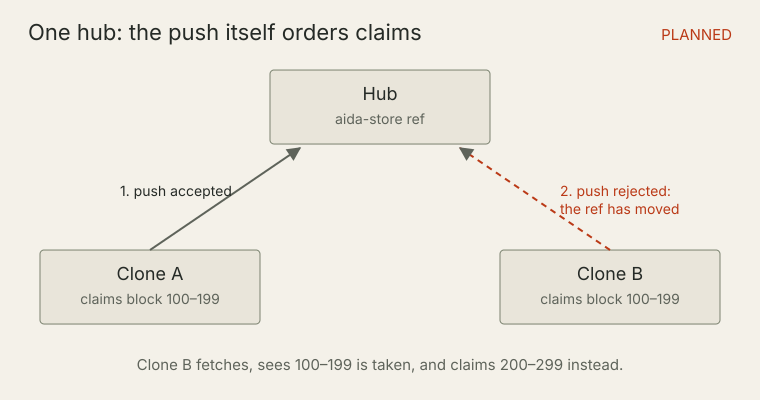
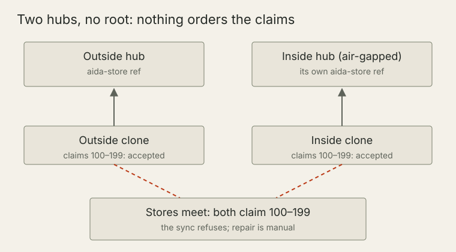
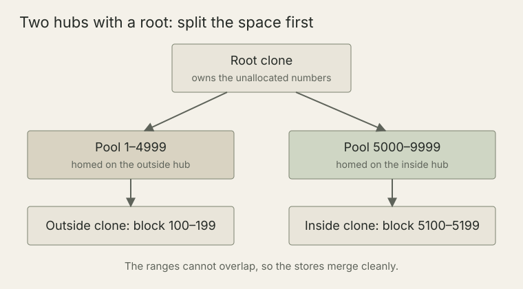
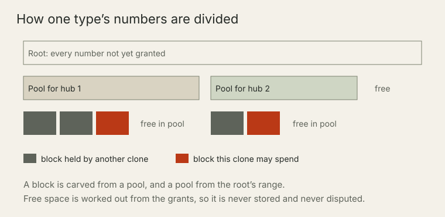

# Support for air-gapped development

<!-- trace:TASK-B6B1278890774EF993D2EBC327862470-277 | ai:claude -->

AIDA keeps requirements in Git, so a team on an isolated network can use it with an internal Git server. Its records travel the way code does. The one thing that needs planning is how short spec IDs such as `TASK-42` stay unique when two networks hand them out without seeing each other. This page explains the parts involved, shows where a collision comes from, and answers one question: does your project need an ID root?

> Some of what follows is built and some is planned. Each section says which. Anything marked **Planned** is not available in the current release.

## The parts

**Status: built.** Each part below exists today as a record or a setting, with checks on it. What is still planned is the commands that grant a pool to a hub and claim blocks from an upstream. The sections that follow say where each one fits.

- **Hub.** A Git server the requirement store syncs through: GitHub, GitLab, or a bare repository on an internal host. A mirror that only copies another hub's records, listed under `[store.sync] mirror_remotes`, is the same hub, not a second one.
- **Store ref.** The `aida-store` branch on a hub. A push to it succeeds only if nobody else moved it first, so one hub settles any race between two clones.
- **Root.** The one clone per store that owns every number not yet handed out. You make a clone the root with `aida node enroll-root`.
- **Pool.** A range of one spec type's numbers granted to a holder and homed on one hub's store ref. Claims against a pool are pushed to that hub and nowhere else.
- **Block.** A smaller range carved from a pool and bound to one clone. A clone mints short IDs from its own blocks.

Every clone also has a node identity: a random identifier with no host, user or email in it. When a clone has no block it can use, it mints node-local IDs of the form `<TYPE>-<node>-<n>`. Those never collide, because no two clones share a node, so they need no coordination at all. You can give a node a friendly label with `aida node alias`, so `TASK-<node>-95` displays as `TASK-HOME-95`.

## One hub: the push will order every claim

**Status: planned.** Today only the root can claim a block. On any other clone a block claim refuses and `aida add` mints a node-local ID instead. What is true today is the ordering this mechanism will rely on: a push to the store ref succeeds only if nobody else moved the ref first.



Once clones can claim blocks from their upstream, a hub that every clone pushes to will decide who got there first. If two clones try to claim the same block, both push; the first push lands and the second is rejected because the store ref has moved. The losing clone will fetch, see that the block is taken, and claim another. No claim will be accepted twice.

## Two hubs without a root: why the root exists

**Status: illustration, not something the current release lets you do.** A clone that is not the root cannot claim a block, so it mints node-local IDs and this collision cannot arise as drawn. The scenario shows what would go wrong if each hub handed out the same numbers on its own, which is why claiming blocks requires a root. The sync-time conflict check described after the diagram is built today.



An air-gapped network has its own hub. Suppose a clone outside could claim a block through the outside hub and a clone inside could claim the same block through the inside hub. Each push would succeed, because each moves a different ref. Nothing would compare the two claims until the stores met again, and then both would say they own the same numbers.

AIDA guards that boundary today. Before every store sync it reads the allocation claims on both sides and refuses the sync if any two conflict. A refusal changes nothing: no counters, history or refs move and nothing is pushed. There is no override. `aida db audit-ids --against <ref>` lists each conflict and a manual repair plan. Repair keeps every record and its old ID as an alias; nothing is renumbered automatically. The check prevents silent damage, but the repair is work you would rather not do.

## Two hubs with a root: split the space first

**Status: partly built.** Built today: the root, each clone's declared upstream hub, the pool and block records, and the checks on them. **Planned:** the command that grants a pool to a hub, and claiming blocks from the upstream automatically during `aida push` or on request.



The root prevents the collision instead of catching it. It owns the unallocated numbers and, once pool grants ship, will hand each hub its own pool before anyone on that hub claims a block. Clones will claim blocks only from the pool homed on their own hub, so the outside and inside ranges cannot overlap, and the two stores merge cleanly when they meet.

## How the number space is divided

**Status: built.** The pool and block records, the lineage checks and the spend rules below work today. Because no command grants a pool yet, these rules today mainly decide whether a clone can use a block it holds or falls back to node-local IDs.



Each spec type has its own number space, divided as a tree. The root holds the whole range. A pool is a grant carved from the root's range, and a block is carved from a pool. Each grant records the pool it came from, so the chain from any block back to the root can be checked. Free space is never stored: it is worked out from the grants, so two stores merged from different hubs add up cleanly instead of disagreeing about a counter.

A clone may spend a block only when all of these hold:

- the block is bound to that clone's node;
- the block's chain of pools reaches a root pool held by the enrolled root;
- off the root, the block's pool is homed on the hub the clone declared as its upstream.

A block that merely appears in a store imported from elsewhere is never spendable. When a clone cannot spend a block, `aida add` falls back to a node-local ID and prints the reason once per session: no upstream declared, no block from the upstream yet, no pool lineage, or the block is used up. `aida node show` lists the clone's role, its upstream, the store's root, every pool with its free space, and each of the clone's blocks with whether it can be spent and why not.

Inconsistent grants, such as two pools that overlap, a block outside its pool or a pool whose parent is unknown, are reported as conflicts and never resolved automatically.

## Does your project need an ID root?

- **You are content with node-local IDs.** No. They work on any number of hubs, offline, with no setup.
- **You want short IDs and the store lives on one hub.** Today, yes: short agreed IDs require an enrolled root on every project. **Planned:** a single-hub mode in which the hub's store ref is the authority, so a one-hub project gets short IDs with no root and no enrollment step.
- **The store lives on more than one hub that clones push to independently**, such as an air-gapped network with its own Git server. Yes. Only a root can split the numbers between hubs before either hub sees a claim.

A mirror never counts as a second hub. `aida node upstream` refuses to name a mirror, because a mirror copies records and never grants blocks.

## Bringing an air-gapped team online

This walkthrough shows the intended sequence. Each step says whether it works today.

### Step 1: enroll the root outside

**Status: works today.** On the primary clone outside the gap, preview and then enroll:

```
aida node enroll-root --dry-run
aida node enroll-root
```

The root is recorded in the store, and the command refuses if another clone already holds the role. Running it again on the root changes nothing. Choose this clone carefully: handing the root role to another clone is **planned**, not yet available.

### Step 2: point outside clones at the outside hub

**Status: works today.** On each other outside clone:

```
aida node upstream origin
aida node show
```

### Step 3: grant the inside hub its own pool

**Status: planned.** The root will grant a pool for each spec type, homed on the inside hub's store ref, so that its range is reserved before the store crosses the gap. The pool records and their checks exist today, but no command creates a grant yet.

### Step 4: carry the store across the gap

**Status: untested.** Git can carry the store branch on removable media as a bundle file:

```
git bundle create aida-store.bundle aida-store
```

Inside, fetch the branch from the bundle and push it to the inside hub. Whether a pool that arrives this way counts as granted, rather than as a record in an imported store that is never spendable, has not been tested yet. This page will be updated when it has.

### Step 5: point inside clones at the inside hub

**Status: works today, with node-local IDs.** On each inside clone, declare the inside hub as the upstream:

```
aida node upstream <inside-remote>
```

Claiming a block from that hub is **planned**. Until it ships, inside clones mint node-local IDs, and `aida add` says why once per session. Work is not blocked; the IDs are just longer.

### Step 6: bring the work back out

**Status: the checks work today; the bundle crossing is untested.** Carry the inside store out the same way, fetch it into a local ref, and audit it before you sync:

```
aida db audit-ids --against <ref>
```

The audit exits cleanly when no claim conflicts. Every store sync runs the same check and refuses any overlap, so a mistake in the earlier steps stops at the boundary instead of spreading. To keep more than one connected hub level in day-to-day use, see [Multi-hub sync](multi-hub-sync.md).

## Know the boundary

- Node-local IDs, the root, upstream declarations, pool and block records, the spend checks and the sync-time conflict check are built.
- Granting a pool to a hub, claiming blocks from the upstream, single-hub mode without a root and handing over the root role are planned.
- Carrying a pool across an air gap in a Git bundle has not been tested.

The storage reference, [Storage and the requirement store](cli/10-storage.md), documents the current commands and checks in full.
