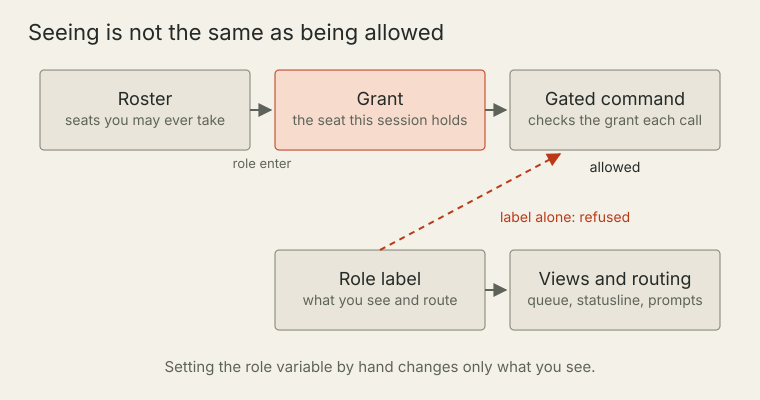
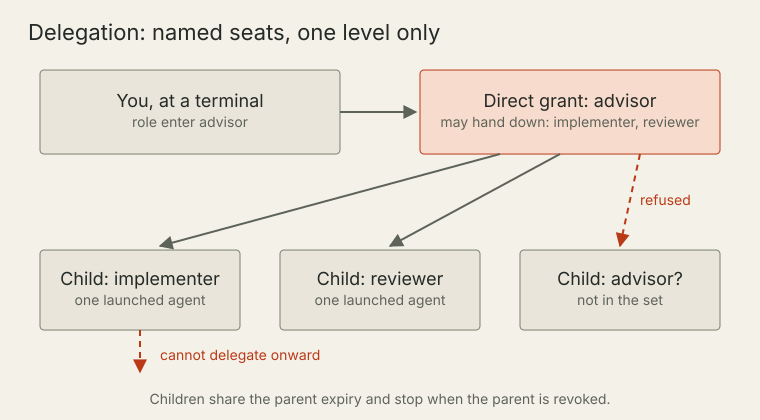
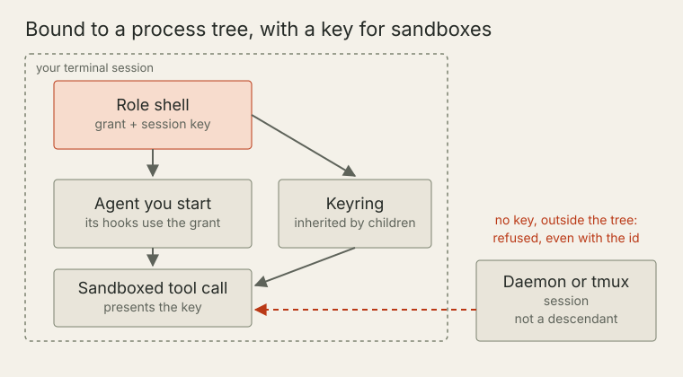
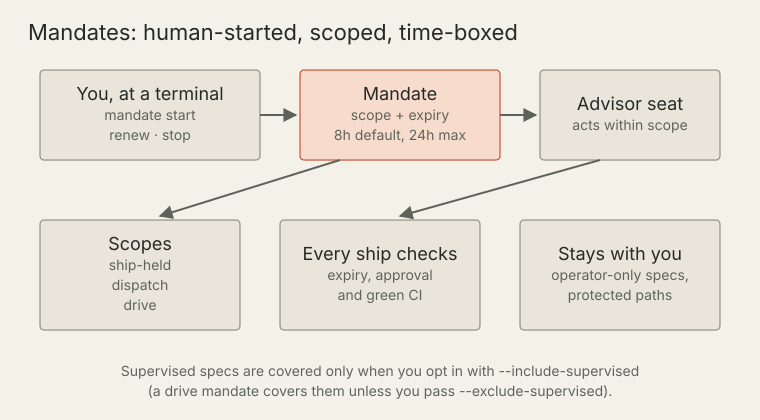
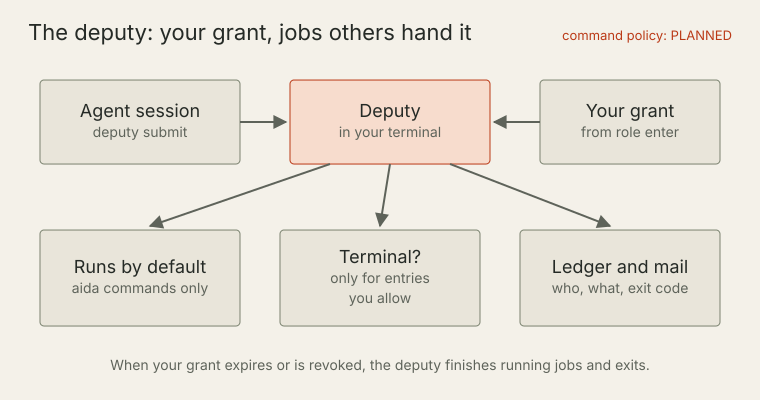

# Who may do what: roles, seats, grants and mandates

<!-- trace:TASK-2606 | ai:claude -->

AIDA runs a team of agents and people in one repository. Some actions change what everyone else sees: approving a spec, recording a review, shipping a held change. AIDA decides who may take those actions with a small set of records. This page explains each one, how they fit together, and which steps always need a person at a keyboard.

> Most of what follows is built and in the current release. Two pieces are planned and are marked **Planned** where they appear: a per-deputy command policy, and handing authority from one person to another.

## The terms on this page

- **Role.** A named working context, such as advisor, implementer or reviewer. It shapes what you see: queue filters, the statusline, the instructions a launched agent starts with.
- **Seat.** The authority that goes with a role. Advisor routes and approves work, implementer builds one spec, reviewer records verdicts on a change.
- **Roster.** The list of seats each person on the team may take. It is a ceiling, not an active seat.
- **Grant.** A record that this session holds one seat, until a set time. Authority-gated commands check the grant, not the role name.
- **Launcher.** An AIDA command that starts an agent session for you, such as `aida agent new` or `aida queue work`.
- **Child grant.** A grant a launcher issues to an agent it starts, for one seat the parent session chose to hand down.
- **Mandate.** A time-boxed permission a person starts at their terminal so the advisor seat can do named things while they are away.
- **Deputy.** A process in your terminal that runs commands other sessions hand it, under your grant.
- **Hold.** A marker that keeps a change from merging until someone with the right authority clears it. AIDA records why each hold was placed, for example that the spec needs a person's review or that a reviewer stepped aside.

## What a role shows you, and what a grant lets you do

**Status: built.** A role name is a label. It decides what you see and how work is routed to you. It does not let you do anything. Setting the role variable by hand changes only the label: a gated command looks for a valid grant for that seat, finds none, and refuses. For example, trying to approve a spec from a shell that only carries the advisor label prints a refusal like this:

```
approving <spec> needs advisor authority. Enter the advisor role at an interactive TTY with `aida role enter advisor`, or ask an advisor session to do it.
```



The grant is checked again on every gated call, so revoking it takes effect at once. An MCP server takes the grant it was started with and re-checks it on each call, but it cannot pick up a different grant while it runs. To change a server's authority, enter the seat at your terminal and restart the server.

## The roster is a ceiling; the grant is the seat you hold

**Status: built.** The roster says which seats you may ever take. Adding or removing a seat is a roster change, made at an interactive terminal with `aida team allow-seat <user> <seat>` and `aida team disallow-seat <user> <seat>`. A session cannot give itself a seat the roster does not allow.

The grant says which seat this session holds right now. One shell holds one seat at a time: entering a seat revokes the grant the shell held before.

## Minting a grant at your terminal

**Status: built.** You take a seat by running `eval "$(aida role enter <seat>)"` in a shell at an interactive terminal. If you install the shell helper with `aida dev shell-init --install`, `aida role enter <seat>` works on its own. The command checks your roster, then mints a grant for that shell. `aida role status` shows the seat you hold, when it expires and which processes it is bound to. `aida role end` revokes it.

An agent session that AIDA launched cannot mint a grant of its own. It works under whatever its launcher gave it. That is why the terminal is the starting point: the person at the keyboard decides what authority exists.

When you launch an agent for a seat from a terminal that holds no grant, `aida agent new` can offer a one-time grant instead of refusing. It explains what it will issue and asks you to type `y`. Only a typed `y` issues it; Enter, `n` or end of input issues nothing. That grant is bound to the launcher, never exported to your shell, and lasts at most 8 hours. Scripts that want a plain refusal pass `--grant-inline no`.

## Child grants and delegation

**Status: built.** An advisor often starts implementers and reviewers. Each agent it launches gets its own child grant for one seat. A session can hand down only the seats it named when it was entered:

```
eval "$(aida role enter advisor --delegate-seat implementer --delegate-seat reviewer)"
```



- **Empty by default.** With no `--delegate-seat`, a session can delegate nothing, and a launch that asks for a seat refuses and names the flag to add. Entering advisor without the flag asks once whether to include advisor itself; the default answer is no.
- **One seat per child.** A child grant names one seat, from the parent's delegation set, for one launched session.
- **No onward delegation.** A child cannot delegate further.
- **Tied to the parent.** A child grant shares its parent's expiry. It stops working when the parent is revoked or the roster no longer allows the seat.

Not every launcher issues a child grant. `aida agent new --role <seat>` and `aida queue work` do. `aida session new` issues none: its role option only labels the session, and the agent inherits the parent's grant from the environment. The [roles and sessions reference](cli/06-roles-sessions.md) has the full table.

## Bound to a process tree, with a key for sandboxed tool calls

**Status: built.** A grant id is not a password you can pass around. A grant from `aida role enter` is bound to the shell that ran it and that shell's terminal session. Any process started in that terminal session can use it: an agent you start there, its tool calls and its hooks. A process outside it cannot, even with the grant id in its environment. Matching uses each process's start identity, so a recycled process id never matches. A grant id copied from a file or a log into another session is refused.



Agent sandboxes add a wrinkle. The tool an agent runs in, such as Claude Code, often runs commands in a sandbox, and a sandbox may run each tool call in its own process namespace, where the bound shell is invisible. So entering a seat also places a one-time secret, the **session key**, in that shell's Linux session keyring. Only that shell and the processes it starts can read it, and sandboxes inherit the keyring. A sandboxed tool call presents the grant by holding the key. The grant record keeps only a digest of the secret, and the secret never appears in a command line, an environment variable, a file or shell history.

A session that does not descend from your shell holds no key: for example, one started in the background with `aida agent new --bg`, or one a tmux server starts. Its grant-gated calls are refused with a sentence naming the fix: start it from the role shell. Where the kernel refuses keyrings, as some containers do, a grant falls back to its process binding, and a sandboxed caller is refused with that reason, never allowed.

## Expiry and renewal

**Status: built.** A grant lasts 24 hours by default. `--ttl` sets another length, such as `90m` or `72h`, up to the configured cap (24 hours unless raised, never more than 168). The statusline shows the time left once a grant is within two hours of expiry, and an agent session sees a notice at two hours, thirty minutes and expiry. Renewing means entering the seat again at your terminal: `eval "$(aida role enter <seat>)"`.

## Mandates: keeping work moving while you are away

**Status: built.** Normally a held change waits for a person. A mandate lets the advisor seat do named things without you, for a set time. You start it at your terminal:

```
aida mandate start --ship-held --ttl 8h --reason "overnight run"
```



- **Time-boxed.** 8 hours by default, at most 24. `aida mandate renew` extends it in place, keeping its scope and reason; `aida mandate stop` ends it at once. Start, renew and stop need a person at an interactive terminal. `aida mandate status` is open to anyone.
- **Scoped.** `--ship-held` lets the advisor seat ship held changes. It still needs all of these: an independent approval of the change's current commit, from neither the implementer nor the shipping session; work the advisor did not author; and green CI. The option that lets a ship accept an approval of an older commit is never honoured under a mandate. `--scope dispatch` adds queueing dispatch work. `--drive` also covers signing off design sketches, dispatching fixers and restarting a crashed long-running agent run you started at a terminal, and turns on a check every 15 minutes that hands each stalled piece of work to the advisor.
- **Supervised specs.** Sensitive specs (security, containment, authority, guided and keystone work) stay with a person unless you pass `--include-supervised`. A drive mandate covers them unless you pass `--exclude-supervised`.
- **Operator-only specs.** A spec tagged operator-only, or in operator or decide mode, is never covered by any mandate. Once a spec has been in that class, it stays excluded even if the tag is removed.
- **Checked every time.** Expiry is checked by every ship as it decides, again under the merge lock and once more just before the merge call. Each release is recorded, and the statusline of every session shows the mandate and its time left.

Some paths never ship under a mandate: the project's authority configuration and the code that makes these decisions. You can add your own protected paths and actions in `[mandate.human_gates]`; a branch cannot remove them.

## The deputy: your grant, running jobs others hand it

**Status: built, with one planned piece.** Agents in a sandbox sometimes need a command that only your shell can run. Instead of a hand-rolled script loop, start a deputy in your terminal: `aida deputy`. Other sessions submit work with `aida deputy submit -- <command>`, and the deputy runs each job under the seat grant your terminal holds.



- **Started by you.** It refuses to start unless stdin, stdout and stderr are your terminal and your shell holds a grant. It will not start inside an agent session, a headless run or another deputy job.
- **AIDA commands only, by default.** Other programs run only if you add them with `--allow-exec`, and shell scripts only with `--allow-scripts`.
- **No terminal unless you say so.** A job gets a terminal only if its command matches an entry you set at your terminal, such as `aida deputy --allow-tty 'aida merge-hold clear' --ttl 8h`, or later with `aida deputy allow`. An entry never outlasts your grant. Scripts never get a terminal, and neither does a command carrying a gate-bypass flag. Any other job runs without one, so a command that needs a person at the keyboard refuses it.
- **Stops with your authority.** When your grant expires or is revoked, the deputy takes no new jobs and exits once running jobs finish. If a mandate was active when you started it, the same happens when the mandate ends, unless you started the deputy with `--keep-after-mandate`.
- **Recorded.** A ledger records who submitted each job, its command, whether it ran on a terminal and its exit code.
- **Planned.** A per-deputy command policy, and capabilities a submitting session can present, are not built yet. Until they are, the deputy refuses any job that presents a capability, and refuses every job while a command policy file is present, rather than running it as though the check had passed.

## What always needs a person at a terminal

**Status: built.** These steps happen only at an interactive terminal. Holding a grant or a mandate does not stand in for that.

- Taking a seat: `aida role enter` refuses without a terminal. `aida role add` mints a grant only at a terminal; without one it creates the role as a label only, with no grant.
- Changing the roster: `aida team allow-seat` and `aida team disallow-seat`.
- Starting, renewing and stopping a mandate.
- Accepting the one-time grant `aida agent new` offers, by typing `y`.
- Starting a deputy, resuming a paused one, and giving its jobs a terminal.
- Clearing an advisor's escalation to a person.

Holds are the emergency brake. A person at an interactive terminal can reach them even without a grant. A mandate releases only a hold whose recorded reason it covers. A hold that exists only as a label on the pull request, or one placed because a reviewer stepped aside from the change, always needs a person.

## Handing authority to someone else

**Status: planned.** Moving a seat's authority from one person to another, with an acknowledgement, is not part of the current release. Today each person takes their own seats from their own roster entry at their own terminal.

## The threat model

AIDA separates sessions, not operating-system users. Everything runs under one Unix account, and the terminal check confirms an interactive terminal, not that a person is typing. A process running as the same user that forges or copies the files AIDA trusts is outside the threat model. So is a process that wraps itself in a pseudo-terminal to pass the terminal check. The grants and mandates stop agents from acting beyond what they were given by mistake or by drift. They are not a defence against malicious code running as you. Several people sharing one account are not separated from each other either.

## Where to read more

For exact flags and defaults, `aida <command> --help` is the source of truth. The [roles and sessions reference](cli/06-roles-sessions.md) covers roles, grants, launchers and the deputy. The mandate section of the [Git lifecycle reference](cli/04-git-lifecycle.md) covers mandates, drive mandates and human gates. [Trust and evidence](trust-and-evidence.md) explains review, CI and holds.
