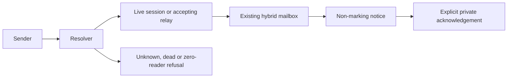

# Addressable agent handles

Date: 2026-10-21 · Specs: STORY-1843, BUG-2204 (delivery only) · Status: advisor-approved with C1–C3 · Complexity: cross-vendor identity/lifecycle

## Approach

Use one project/common-root recipient directory across CLI, MCP and mentions. First repair refusal of unroutable mail against today's identities. Then introduce immutable recipient UUIDs and session bindings, prove raw client hooks, and connect relay lifetime to the same recipient.

## Decisions

The STORY-1843 SKETCH v1 comment and advisor signoff C1–C3 are authoritative. Explicit names use lowercase letters/digits/hyphens, first alphanumeric, maximum 63 characters; invalid explicit names reject with suggested spelling. Launch -n wins, otherwise vendor-role-NN. Relay label owns one immutable logical recipient across rotations. Roles/vendor/person aliases are reserved.

Role mail snapshots live readers, names them, and refuses zero readers unless explicitly queued. Explicit queued role mail assigns once to the first eligible reader. Multiple readers have private receipts. Unknown/dead direct recipients refuse before write. Human inboxes remain available without a live agent.

Only PR4 completes STORY-1843. Earlier PRs say Refs STORY-1843. Each PR gets independent attested review; PR2/PR4 require STRICT review. Author-spawned checkers have no verdict authority.

PR2 ships a migration dry-run and produces a report against the real store. Advisor review is required before write-mode migration ships. Do not silently rebind historical mail or lose original IDs/threads/tombstones/receipts.

## Files in build order

1. PR1: mailbox_resolver.rs; mailbox_root.rs people catalog; mailbox_cmd.rs and mcp.rs send paths; punt_done.rs mentions; resolver/transport tests and collaboration docs.
2. PR2: agent_registry.rs/agent_launch.rs reservation and native bindings; mailbox message/receipt extensions; mailbox migrate dry-run; agent_registry_root.rs and statusline_contract.rs/statusline_cmd.rs.
3. PR3: shipped Claude/Codex/Agy hook templates, scaffolding and context/mail handlers; session-communication documentation and actual-payload tests.
4. PR4: relay controller reservation/end reconciliation and notification outbox in AIDA; aida-relay/bin/relay.sh stable label, child binding, startup/handoff and explicit reuse selection; coordinated version gate.

## Critical files

mailbox_cmd.rs and mcp.rs must use the same refusal/canonicalization behavior. agent_registry.rs liveness must distinguish process start identity and ended records. Relay's EXIT trap alone cannot recover crash-delivery failures. Codex shared app-server environment must never bind a different session.

## Reusable helpers

Reuse registry_entry_is_live, register_existing_agent/register_spawned_agent, write_atomic, inbox_for/merge_dedup, existing message persistence/digest store locking, read_receipts/record_seen and the shared statusline contract. Keep historical inspection separate from send-time liveness refusal.

## Risks and gotchas

Advisor 11:01 ruling: PR1 ships refusal and current-reader diagnostics without a queue flag; explicit queue assignment/private receipts move to PR2 with UUID bindings. Existing registry IDs are not necessarily inbox names; do not falsely claim per-process delivery via a shared vendor inbox. Ambiguous names refuse. Unsupported older mailbox writers must not erase new metadata.

Agy currently ships expiry PreInvocation only. Verify real startup/next-turn capability and supported versions; request acceptance adjustment if unsupported. Never fabricate Claude-shaped Agy hooks.

## Tests

Named coverage: unknown/dead/no-write; role zero/one/many; duplicate names; stored spelling and people; CLI/MCP/mention parity; private acknowledgement; allocation races/PID reuse; shared daemon isolation; legacy mail migration; actual Claude-to-Agy next-turn delivery; relay inter-session gaps, send/end race, crash replay, exactly-once bounce visibility, no bounce loops, label reuse count/explicit handover; no authority escalation.

## Verification

Run focused Rust/CLI tests, cargo fmt --all -- --check, and make check-ci-fast before every push. Cite completed CI at each actual head. Check the independent attested verdict at that head before integration; never self-record approval.

## Followups

PR1 boundary ruling accepted (advisor mail 81b4a4f8). Agy 1.4.2 native SessionStart/PreInvocation event existence was proved by an isolated real CLI smoke and accepted by advisor; cross-vendor delivery still requires PR3 proof. Migration report approval and the old-writer layout/enablement policy remain explicit advisor gates. BUG-2204 current-head review-verdict truth checking remains a separate acceptance item.

## Related

STORY-1843 sketch/signoff comments; BUG-2204; TASK-1766; docs/agents/session-communication.md.
