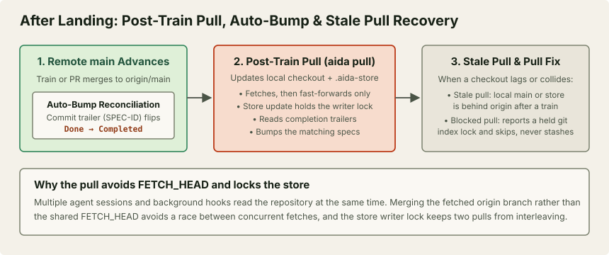

# From a conversation to a maintainable system

<!-- trace:TASK-B6B1278890774EF993D2EBC327862470-108 | ai:codex -->

AIDA connects the work people and agents do with the intent behind it. Start with a conversation, develop the system, and keep enough structured context for the next change. You can remain involved throughout or delegate selected stages under the project's policy.

## The collaboration loop

- **Discuss the outcome.** A person and coding agent explore the problem, constraints and alternatives. The person can develop, challenge and review the work throughout.
- **Capture agreed intent.** The agent records requirements, acceptance criteria and consequential decisions in the project graph. Ask to inspect the record before implementation.
- **Own a bounded change.** The work is assigned to a role and session. Isolated worktrees give separate changes their own checkout; leases and queue state coordinate ownership.
- **Implement and validate.** Build the agreed behavior, link it to its specs and run the relevant checks. New discoveries can require revised intent or a separate decision.
- **Review independently.** In the governed PR workflow, a separate reviewer evaluates the current change and its evidence. The author's self-check is useful preparation and does not constitute independent approval.
- **Integrate under policy.** The authorized shipping path checks the applicable evidence and gates. Integration can lead to another conversation; a merged change and a released product are separate milestones.

These are stages in an operating model, not a promise that every project uses one autonomy mode. The [configuration guide](configuration-guide.md) explains how execution mode, guidance and authority remain distinct. The graphic is explanatory, not a live dashboard.

## The multi-seat workflow in plain language

<!-- trace:STORY-2839 | ai:claude -->

When several agents work in parallel, status views, logs and handoffs use operational words: lanes, worktrees, leases, seats, grants, merge holds, merge trains, riders, bisect and post-train pulls. This section follows one change through those stages. Exact flags are in `aida <command> --help`; terms are defined in the [product glossary](../aida-core/templates/.aida/discipline/product-glossary.md).

### Tracing one idea from a prompt to main

Follow a single feature idea, *"add jittered retry backoff to the webhook client"*, across five swimlanes:


- **Steps 1–2 (you and the advisor seat).** You describe the idea. The agent captures a Draft spec with intent and acceptance criteria (`aida add`), and an advisor approves it with an execution mode (`aida edit <spec> --status approved --mode drain`). Before any lane starts, a pickability check confirms the spec is work, not human-only, not waiting on a decision and not blocked by an unfinished dependency.
- **Steps 3–4 (the implementer lane).** `aida queue work` picks up the queued spec and launches a fresh session in its own worktree. The agent writes the change and tests, commits with a [commit trailer](../aida-core/templates/.aida/discipline/product-glossary.md#commit-trailer) naming the spec, opens a pull request and marks the spec Done.
- **Steps 5–7 (review, rework and delta review).** CI runs while a [review story](../aida-core/templates/.aida/discipline/product-glossary.md#review-story) routes the pull request to a separate reviewer seat. If the reviewer requests changes, `aida rework` starts a [rework round](../aida-core/templates/.aida/discipline/product-glossary.md#rework-round); the fix is pushed as a new head commit, and a [delta review](../aida-core/templates/.aida/discipline/product-glossary.md#delta-review) checks what changed. `aida review record` stores the approval for that exact head.
- **Steps 8–10 (merge train, landing and post-train pull).** The approved pull request boards a [merge train](../aida-core/templates/.aida/discipline/product-glossary.md#merge-train) as a [rider](../aida-core/templates/.aida/discipline/product-glossary.md#rider). When the combined [ci:full](../aida-core/templates/.aida/discipline/product-glossary.md#cifull) run is green, the train lands on main. A [post-train pull](../aida-core/templates/.aida/discipline/product-glossary.md#post-train-pull) (`aida pull`) brings the commits into each checkout and moves the spec from Done to Completed.

### Act 1: The workshop — queues, lanes, worktrees and leases

Two agents editing the same folder at the same time overwrite each other's files. AIDA gives each active spec or review its own lane instead.


- **Queue and pickup.** Approved specs wait in a role's queue (`aida queue list`). `aida queue work` launches the head of the active role's queue, or a named item, in a fresh session.
- **Lane and worktree.** A lane is the whole unit of isolated work: the spec, the session, its seat and its lease. Its worktree is the separate checkout on disk, a sibling directory on the task's branch, so the main checkout is never touched.
- **Session and lease.** The session record names the spec, branch, worktree and owning process. Its lease tells every other session that this spec and branch are occupied, so a second pickup refuses rather than clobbering work. `aida session leases` lists them.
- **Handoff and rotation.** A long conversation eventually fills the model's context window. Before that, the session writes a [handoff](../aida-core/templates/.aida/discipline/product-glossary.md#handoff) brief (the `/aida-handoff` skill) and a fresh session continues from it. `aida session handoff` only advises whether a fresh session or compaction is safer.
- **Crashes and sweeps.** If a process dies without ending cleanly, its lease names a dead process and its worktree goes stale. `aida session leases` marks it stale; `aida session reap` and the hourly `aida session hygiene` pass clean up finished sessions and keep any uncommitted work for a person to salvage or discard. `aida session end` ends a session deliberately, and `aida worktree gc` reports leftover checkouts.

A lease is different from a lock file. A lock file (for example the store writer lock or git's `index.lock`) protects one read-modify-write for milliseconds; a lease records ownership for the whole life of a session, often hours.

### Act 2: The control tower — roles, seats, grants and mailbox

A [role](../aida-core/templates/.aida/discipline/product-glossary.md#role) label shapes what a session sees: its instructions, queue and statusline badge. It confers no authority. A privileged step, such as recording a review verdict, clearing a merge hold or shipping to main, needs a [seat](../aida-core/templates/.aida/discipline/product-glossary.md#seat) held under a live [grant](../aida-core/templates/.aida/discipline/product-glossary.md#grant), minted at an interactive terminal with `aida role enter <seat>` or delegated as a [child grant](../aida-core/templates/.aida/discipline/product-glossary.md#child-grant). An operator can also start a [mandate](../aida-core/templates/.aida/discipline/product-glossary.md#mandate) that lets unattended sessions take bounded steps.

| Seat | What it owns |
| --- | --- |
| **Product** | Intake, acceptance-criteria quality, backlog order and launching eligible work |
| **Advisor** | Judgment: spec disposition, design-fork punts, review verdicts and merge readiness |
| **Integration** | The mechanical cascade: merges into the integration branch, promotions and merge trains |
| **Implementer lanes** | One bounded spec each, in an isolated worktree, under any supported agent vendor |

Seats coordinate through the [mailbox](../aida-core/templates/.aida/discipline/product-glossary.md#mailbox) rather than a vendor's in-memory chat, so a message reaches the seat whether Claude Code, Codex or Antigravity is hosting it, and leaves a record:

```bash
aida mailbox send --to seat:advisor --intent fyi "Promotion landed on main; run aida pull"
aida mailbox send --to seat:integration --intent request "Check train eligibility for open PRs"
aida mailbox send --in-reply-to <message-id> "Confirmed; the train is green"
aida mailbox inbox
```

`--to seat:<name>` reaches whichever session currently holds that seat, and `--in-reply-to` finds the sender's seat even after they rotated into a fresh conversation.

### Act 3: Landing paths — direct ship, merge train and integration promotion

An approved pull request reaches main by one of three paths. Each checks the same evidence: an approval recorded at the exact head commit, green required CI, and no [merge hold](../aida-core/templates/.aida/discipline/product-glossary.md#merge-hold).


- **Path A — direct ship (`aida pr ship <n>`).** One pull request is squash-merged as one commit. A refusal names its gate in the exit code, for example a stale CI definition or a merge hold.
- **Path B — merge train (`aida pr train <n>…` or `--all-ready`).** Two pull requests that are each green can still break main together. A train stacks main plus one squash commit per rider, checks each carries exactly its approved diff, and opens a `train/*` pull request so CI runs on exactly what main will receive. On a tiered repository a rider must already have a green full-tier run at its head. `aida pr train --check --all-open` says which pull requests would ride and why not; `--dry-run` previews the plan.
  - **Green:** when the train is green and main has not moved, it is rebase-merged pinned to its tested head, and each rider's pull request is closed with a pointer to its commit.
  - **Red:** a failing test is never simply rerun. The train is split in halves ([bisect](../aida-core/templates/.aida/discipline/product-glossary.md#bisect)) until each bad rider is isolated and left out with a comment. Only a run cancelled before it produced a test result is retried, once.
  - **Autoland:** `aida land run` drives this loop: it launches reviewers and rework lanes, releases holds whose condition is met, and sends every ready change to one train. `aida land status` shows each open change's state.
- **Path C — integration branch and promotion.** Coupled work lands first on a shared integration branch (`aida integration merge`), is checked together, and reaches main in one promotion. `aida integration promotion-check` refuses a promotion that contains a change without an approval at the head that was merged. A `(Refs <spec>)` trailer marks a partial slice; only a completing trailer moves the spec to Completed.

### Act 4: After landing — post-train pull and recovery

Landing on the remote main is not the last step. Local checkouts and the requirement store must catch up with what landed.



- **Auto-bump.** When a commit with a completing trailer `(<spec>)` reaches main, `aida pull` reads it and moves the spec from Done to Completed. A `(Refs <spec>)` trailer leaves the spec open.
- **Post-train pull.** After a train or promotion lands, every other checkout is behind. `aida pull` fetches and fast-forwards the code branch, then syncs the `aida-store` branch under the store writer lock. It merges the fetched branch rather than relying on the shared `FETCH_HEAD`, which concurrent fetches can overwrite.
- **Stale or blocked pulls.** If another git process holds the index lock, `aida pull` says so and skips the code update rather than stashing the working tree; wait for that process and pull again.

## What progress means

In the standard PR lifecycle, Draft captures an idea, Approved records agreement, In Progress means implementation has started, and Done means work is finished on a branch. Completed follows recognized integration evidence on the default branch. Planned is optional; Needs Attention and terminal dispositions handle work that cannot simply proceed.

A status is a recorded signal, not proof that deployed behavior is correct. Read the [lifecycle reference](lifecycle.md) for transition rules and exceptions. Deployment and release need their own project workflow.

## Four records with different jobs

- **Code history:** source, tests, trace comments and commits live on the product's code branches. Traces connect implementation to structured intent; they do not themselves approve a change.
- **Canonical intent:** the default git-canonical store uses the orphan `aida-store` branch and a live `.aida-store/` worktree. YAML spec objects contain requirements, relationships, comments and transition history. Store history is separate from code history and must be synchronized deliberately. Sibling-store projects use their configured separate store repository.
- **Derived read cache:** `.aida/cache.db` indexes store data for reads. It is rebuildable from the available canonical store and is not a replacement for that history. Cache reads can report stale, deferred or busy context; inspect freshness rather than assuming every displayed view is current.
- **Local operational evidence:** session files, verdict artifacts, holds and handoff notes have local runtime locations under `.aida/`; machine grants and mandates have their own local authority context. Their scope, validation and retention differ from canonical intent. A store clone or cache rebuild does not recreate all of them or confer authority.

This is a map of responsibilities, not a backup recipe or complete directory inventory. Some coordination events also live in the store, and the [storage reference](cli/10-storage.md) describes the particular data surfaces. Back up the canonical histories and needed local evidence according to your actual project setup.

## Keep the intent useful

For maintenance, ask the agent to locate the requirement and decision behind an existing behavior before changing it. `aida why` can resolve a code location through nearby trace comments. For enhancement, use the current acceptance criteria and relationships to identify what needs revising. For collaboration, hand over the agreed intent, implementation links and unresolved questions so another person or agent can continue.

The graph is structured project memory, not a transcript archive or complete observation of everything an agent did. Its value depends on what was captured and kept accurate. Ask for a capture sweep at handoff, verify the record and keep consequential corrections explicit.

## Read the evidence behind the model

The [getting-started guide](getting-started.md) covers everyday conversational use. Operators can inspect `aida show`, `aida history`, `aida status` and `aida cache status`; exact flags are in command help. Contributors can inspect the [cache implementation](../aida-core/src/db/cache.rs), [storage abstraction](../aida-core/src/storage.rs), [session lifecycle](../aida-cli-lib/src/session_end.rs) and [product architecture](../OVERVIEW.md#architecture) for the source behind these distinctions.
