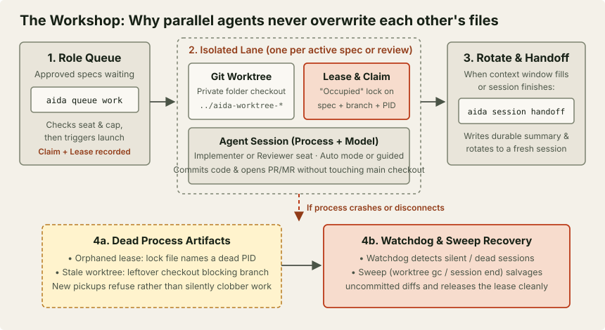
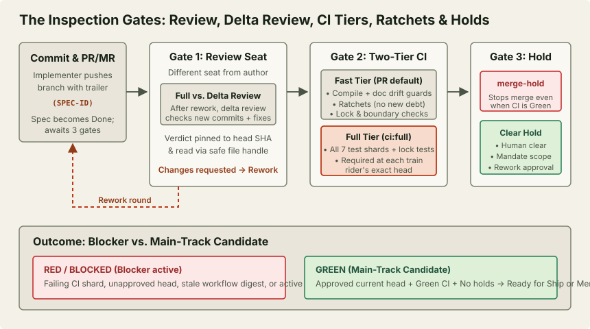
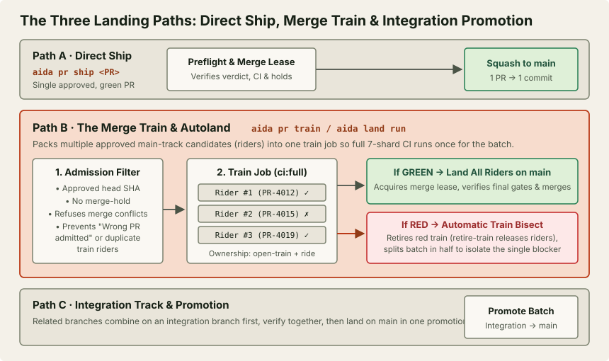

# From a conversation to a maintainable system

<!-- trace:TASK-B6B1278890774EF993D2EBC327862470-108 STORY-b6b1278890774ef993d2ebc327862470-762 STORY-2852 | ai:antigravity -->

AIDA connects the work people and agents do with the [intent](../aida-core/templates/.aida/discipline/product-glossary.md#intent) behind it. Start with a conversation, develop the system, and keep enough structured context for the next [bounded change](../aida-core/templates/.aida/discipline/product-glossary.md#bounded-change). You can remain involved throughout or delegate selected stages under the project's [policy](../aida-core/templates/.aida/discipline/product-glossary.md#policy).

When many agents work in parallel, you will see operational terms in status views, logs and handoffs: **lanes**, **worktrees**, **leases**, **lock files**, **delta reviews**, **ratchets**, **merge holds**, **merge trains**, **riders**, **bisect**, **post-train pulls**, and the **state enums** that drive them. This guide walks through the six stages of that workflow in plain language so you do not need to be a Git or AIDA specialist to read what the system is doing.

## The collaboration loop

- **Discuss the outcome.** A person and coding agent explore the problem, constraints and alternatives. The person can develop, challenge and review the work throughout.
- **Capture agreed intent.** The agent records each [spec](../aida-core/templates/.aida/discipline/product-glossary.md#spec), its [intent](../aida-core/templates/.aida/discipline/product-glossary.md#intent), verifiable [acceptance criteria](../aida-core/templates/.aida/discipline/product-glossary.md#acceptance-criteria), and consequential architecture decisions ([ADRs](../aida-core/templates/.aida/discipline/product-glossary.md#adr)) in the [project graph](../aida-core/templates/.aida/discipline/product-glossary.md#project-graph). Ask to inspect the record before implementation.
- **Own a bounded change.** Each [bounded change](../aida-core/templates/.aida/discipline/product-glossary.md#bounded-change) is assigned an [execution mode](../aida-core/templates/.aida/discipline/product-glossary.md#execution-mode), a [role](../aida-core/templates/.aida/discipline/product-glossary.md#role), and a [session](../aida-core/templates/.aida/discipline/product-glossary.md#session). Isolated [worktrees](../aida-core/templates/.aida/discipline/product-glossary.md#worktree) give separate changes their own checkout; [leases](../aida-core/templates/.aida/discipline/product-glossary.md#lease) and [queue](../aida-core/templates/.aida/discipline/product-glossary.md#queue) [state](../aida-core/templates/.aida/discipline/product-glossary.md#state) coordinate ownership.
- **Implement and validate.** Build the agreed behavior inside a [sandbox](../aida-core/templates/.aida/discipline/product-glossary.md#sandbox), link it to its specs and run the relevant checks. New discoveries can require revised intent or a separate decision.
- **Review independently.** In the governed PR workflow, a separate reviewer performs an [independent review](../aida-core/templates/.aida/discipline/product-glossary.md#independent-review) of the current [head](../aida-core/templates/.aida/discipline/product-glossary.md#head) commit and its evidence (using AIDA's [deterministic & adversarial code review engine](showcase/code-review.html)). The author's self-check is useful preparation and does not constitute independent approval.
- **Integrate under policy.** The authorized [landing path](../aida-core/templates/.aida/discipline/product-glossary.md#landing-path) checks the applicable [ledgers](../aida-core/templates/.aida/discipline/product-glossary.md#ledger) and [gates](../aida-core/templates/.aida/discipline/product-glossary.md#gate). Integration can lead to another conversation; a merged change and a released [milestone](../aida-core/templates/.aida/discipline/product-glossary.md#milestone) are separate steps.

These are stages in an operating model, not a promise that every project uses one [autonomy mode](../aida-core/templates/.aida/discipline/product-glossary.md#autonomy-mode). The [configuration guide](configuration-guide.md) explains how [execution mode](../aida-core/templates/.aida/discipline/product-glossary.md#execution-mode), guidance and authority remain distinct. The graphic is explanatory, not a live dashboard.

## How an idea becomes realized: four human-perspective workflows

From your seat at the keyboard, you do not have to manage worktrees, leases, or gate ledgers by hand. You start with an idea — a feature request, a bug report, or an architectural improvement — and choose how closely you want to steer it. The flowchart below shows how an idea moves from initial conversation into one of four workflows based on its clarity and risk.


| Workflow | When You Pick It | What You Do at the Keyboard | What AIDA & Agent Lanes Do | How It Reaches `main` |
| --- | --- | --- | --- | --- |
| **0. Decide & Clarify** (`decide`) | The idea has unresolved product or design questions | Run `/aida-grill` or `aida decide` to answer the open fork and tighten [acceptance criteria](../aida-core/templates/.aida/discipline/product-glossary.md#acceptance-criteria) | Refuses to launch an implementation [lane](../aida-core/templates/.aida/discipline/product-glossary.md#lane) until the fork is resolved | Transitions to `guided`, `drive`, or `drain` once clarified |
| **1. Interactive Guided** (`guided`) | High-risk keystone, security, containment, or gate changes | Pair step-by-step via `/aida-guided-implement`; inspect the diff and run `aida merge-hold clear` | Co-authors each slice with you in the session and places a mandatory [merge hold](../aida-core/templates/.aida/discipline/product-glossary.md#merge-hold) | Passes [independent review](../aida-core/templates/.aida/discipline/product-glossary.md#independent-review) + `ci:full`, then you clear the hold and [ship](../aida-core/templates/.aida/discipline/product-glossary.md#ship) |
| **2. Supervised Drive** (`drive`) | A well-scoped feature where you want to inspect the PR before merge | Approve with `aida approve <spec> --mode drive`, run `aida do <spec>`, and review the resulting PR | Spawns an isolated [lane](../aida-core/templates/.aida/discipline/product-glossary.md#lane) and [worktree](../aida-core/templates/.aida/discipline/product-glossary.md#worktree), writes code + tests, opens the PR, and holds for you | Reviewer seat approves [head](../aida-core/templates/.aida/discipline/product-glossary.md#head); you clear the hold and run `aida pr ship` |
| **3. Autonomous Drain & Train** (`drain`) | A de-risked backlog of stories or bug fixes with clear acceptance criteria | Groom the queue (`/aida-backlog-groom`), optionally start a [mandate](../aida-core/templates/.aida/discipline/product-glossary.md#mandate), and run `aida pull` later | Orchestrates implementer + reviewer lanes, runs [delta reviews](../aida-core/templates/.aida/discipline/product-glossary.md#delta-review), and batches [riders](../aida-core/templates/.aida/discipline/product-glossary.md#rider) on a [merge train](../aida-core/templates/.aida/discipline/product-glossary.md#merge-train) | [Autoland](../aida-core/templates/.aida/discipline/product-glossary.md#autoland) merges green trains (or [bisects](../aida-core/templates/.aida/discipline/product-glossary.md#bisect) red ones) and [auto-bumps](../aida-core/templates/.aida/discipline/product-glossary.md#auto-bump) specs to `Completed` |

### Tracing one feature end-to-end (Steps 1 to 10)

To see how all the roles and terms fit together in practice, follow a single feature idea — *"Add jittered retry backoff to the webhook client"* — across the five swimlanes below:


- **Steps ①–② (You and the Advisor seat):** You describe the webhook retry idea in plain English. The agent captures a `Draft` [spec](../aida-core/templates/.aida/discipline/product-glossary.md#spec) with explicit [intent](../aida-core/templates/.aida/discipline/product-glossary.md#intent) and [acceptance criteria](../aida-core/templates/.aida/discipline/product-glossary.md#acceptance-criteria) (for example, maximum retry count, exponential backoff formula, and error codes). In the [advisor](../aida-core/templates/.aida/discipline/product-glossary.md#advisor) seat, you bless the spec (`aida approve <spec> --mode drain`), which checks the [project graph](../aida-core/templates/.aida/discipline/product-glossary.md#project-graph) to confirm no `BlockedBy` dependency is still unfinished.
- **Steps ③–④ (The Implementer lane):** Running `aida queue work` allocates an isolated [lane](../aida-core/templates/.aida/discipline/product-glossary.md#lane): AIDA creates a sibling Git [worktree](../aida-core/templates/.aida/discipline/product-glossary.md#worktree) on disk, writes a session [lease](../aida-core/templates/.aida/discipline/product-glossary.md#lease) bound to the [agent process](../aida-core/templates/.aida/discipline/product-glossary.md#agent-process), and starts the [implementer](../aida-core/templates/.aida/discipline/product-glossary.md#implementer) inside a [sandbox](../aida-core/templates/.aida/discipline/product-glossary.md#sandbox). Your main checkout stays completely untouched while the implementer writes the retry logic, runs unit tests, commits with a [commit trailer](../aida-core/templates/.aida/discipline/product-glossary.md#commit-trailer), and opens a [pull request](../aida-core/templates/.aida/discipline/product-glossary.md#pull-request) (moving the spec to `Done`).
- **Steps ⑤–⑦ (Independent Review, Rework and Delta Review):** Fast [CI](../aida-core/templates/.aida/discipline/product-glossary.md#ci) runs compilation and static [ratchets](../aida-core/templates/.aida/discipline/product-glossary.md#ratchet) while AIDA routes a [review story](../aida-core/templates/.aida/discipline/product-glossary.md#review-story) to the reviewer seat. Suppose the independent reviewer spots a missing timeout check and records `Changes Requested`. AIDA places a rework [merge hold](../aida-core/templates/.aida/discipline/product-glossary.md#merge-hold) and triggers a [rework round](../aida-core/templates/.aida/discipline/product-glossary.md#rework-round) (`aida rework`). The implementer pushes a follow-up commit, and the reviewer runs a targeted [delta review](../aida-core/templates/.aida/discipline/product-glossary.md#delta-review) of the new [head](../aida-core/templates/.aida/discipline/product-glossary.md#head) commit, recording an `Approved` verdict that automatically releases the rework hold.
- **Steps ⑧–⑩ (Merge Train, Landing and Post-Train Pull):** Now a [main-track candidate](../aida-core/templates/.aida/discipline/product-glossary.md#main-track-candidate), the pull request boards the [merge train](../aida-core/templates/.aida/discipline/product-glossary.md#merge-train) as a [rider](../aida-core/templates/.aida/discipline/product-glossary.md#rider) alongside other approved PRs. The train runs the seven-shard [full CI tier](../aida-core/templates/.aida/discipline/product-glossary.md#full-ci-tier) (`ci:full`) once for the combined batch. When it finishes [green](../aida-core/templates/.aida/discipline/product-glossary.md#green), the batch lands on [main](../aida-core/templates/.aida/discipline/product-glossary.md#main), and your next [post-train pull](../aida-core/templates/.aida/discipline/product-glossary.md#post-train-pull) (`aida pull`) syncs the code and [auto-bumps](../aida-core/templates/.aida/discipline/product-glossary.md#auto-bump) the spec to `Completed`.

## Act 1: The workshop — queues, lanes, worktrees, leases and rotation

If two people or agents edit the same folder at the same time, they overwrite each other's files. AIDA prevents that by giving each active task its own isolated [lane](../aida-core/templates/.aida/discipline/product-glossary.md#lane).



- **Backlog, grooming, batches, queues and pickability.** Newly captured specs start in the [backlog](../aida-core/templates/.aida/discipline/product-glossary.md#backlog). An [advisor](../aida-core/templates/.aida/discipline/product-glossary.md#advisor) runs `aida groom` ([groom](../aida-core/templates/.aida/discipline/product-glossary.md#groom)) to tighten [acceptance criteria](../aida-core/templates/.aida/discipline/product-glossary.md#acceptance-criteria), assign an [execution mode](../aida-core/templates/.aida/discipline/product-glossary.md#execution-mode), optionally group related specs into a [batch](../aida-core/templates/.aida/discipline/product-glossary.md#batch) (`batch:<name>`), and route [Approved](../aida-core/templates/.aida/discipline/product-glossary.md#approved) specs into a role's [queue](../aida-core/templates/.aida/discipline/product-glossary.md#queue). Running `aida queue work` (a [launch](../aida-core/templates/.aida/discipline/product-glossary.md#launch)) evaluates [pickability](../aida-core/templates/.aida/discipline/product-glossary.md#pickability) across the [project graph](../aida-core/templates/.aida/discipline/product-glossary.md#project-graph) for blockers, verifies that the [seat](../aida-core/templates/.aida/discipline/product-glossary.md#seat) is free and within the [host concurrency cap](../aida-core/templates/.aida/discipline/product-glossary.md#host-concurrency-cap) ([cap](../aida-core/templates/.aida/discipline/product-glossary.md#cap)), and spawns an [agent process](../aida-core/templates/.aida/discipline/product-glossary.md#agent-process) and AI [model](../aida-core/templates/.aida/discipline/product-glossary.md#model) inside a [sandbox](../aida-core/templates/.aida/discipline/product-glossary.md#sandbox) (using [auto mode](../aida-core/templates/.aida/discipline/product-glossary.md#auto-mode) or interactive [guided mode](../aida-core/templates/.aida/discipline/product-glossary.md#guided-mode) according to the spec's [execution mode](../aida-core/templates/.aida/discipline/product-glossary.md#execution-mode) and the session's [autonomy mode](../aida-core/templates/.aida/discipline/product-glossary.md#autonomy-mode)).
- **Lane and Git worktree.** Each launched task runs in its own [lane](../aida-core/templates/.aida/discipline/product-glossary.md#lane) backed by a dedicated Git [worktree](../aida-core/templates/.aida/discipline/product-glossary.md#worktree) — a separate directory on disk checked out to that task's branch. Five [implementer](../aida-core/templates/.aida/discipline/product-glossary.md#implementer) lanes can compile and run tests side by side without touching your main checkout.
- **Session, claim and lease.** When a lane starts, AIDA moves the spec to [InProgress](../aida-core/templates/.aida/discipline/product-glossary.md#inprogress) and records a [session](../aida-core/templates/.aida/discipline/product-glossary.md#session), a [claim](../aida-core/templates/.aida/discipline/product-glossary.md#claim) on the spec or pull request, and an on-disk [lease](../aida-core/templates/.aida/discipline/product-glossary.md#lease) tied to the running [process](../aida-core/templates/.aida/discipline/product-glossary.md#process). The lease is an "occupied" sign: another session cannot pick up the same work while the lease is live.
- **Handoff and rotate.** Long conversations eventually fill an AI model's context [window](../aida-core/templates/.aida/discipline/product-glossary.md#window). Before that happens, the session writes a [handoff](../aida-core/templates/.aida/discipline/product-glossary.md#handoff) note summarizing what is done and what remains, and AIDA can [rotate](../aida-core/templates/.aida/discipline/product-glossary.md#rotate) a fresh session into the seat without losing progress.
- **Orphaned leases, stale worktrees, GC and sweeps.** If an [agent process](../aida-core/templates/.aida/discipline/product-glossary.md#agent-process) crashes or loses power without ending cleanly, its lease record is left behind as an [orphaned lease](../aida-core/templates/.aida/discipline/product-glossary.md#orphaned-lease) and its folder becomes a [stale worktree](../aida-core/templates/.aida/discipline/product-glossary.md#stale-worktree). AIDA refuses to silently overwrite uncommitted work; instead, the [watchdog](../aida-core/templates/.aida/discipline/product-glossary.md#watchdog) flags the dead session and a cleanup [sweep](../aida-core/templates/.aida/discipline/product-glossary.md#sweep) or garbage collection pass (`aida worktree gc`, see [GC](../aida-core/templates/.aida/discipline/product-glossary.md#gc)) salvages any work and frees the branch.

### Lane vs Git worktree and lock file vs session lease

Newcomers often wonder how a [lane](../aida-core/templates/.aida/discipline/product-glossary.md#lane-vs-worktree) differs from a [worktree](../aida-core/templates/.aida/discipline/product-glossary.md#worktree), and how an OS [lock file](../aida-core/templates/.aida/discipline/product-glossary.md#lock-file-vs-lease) differs from a session [lease](../aida-core/templates/.aida/discipline/product-glossary.md#lease). These two tables separate the concepts:

| Dimension | Lane | Git Worktree |
| --- | --- | --- |
| **What it is** | The complete operational unit of isolated work in AIDA | A secondary filesystem checkout directory created by `git worktree add` |
| **What it contains** | Assigned [spec](../aida-core/templates/.aida/discipline/product-glossary.md#spec) or PR scope + [role](../aida-core/templates/.aida/discipline/product-glossary.md#role) [seat](../aida-core/templates/.aida/discipline/product-glossary.md#seat) + [grant](../aida-core/templates/.aida/discipline/product-glossary.md#grant) + [lease](../aida-core/templates/.aida/discipline/product-glossary.md#lease) + [agent process](../aida-core/templates/.aida/discipline/product-glossary.md#agent-process) + branch + checkout | Just the checked-out source files on disk (`../aida-<scope>`) sharing `.git` object storage with the main repo |
| **Lifecycle** | Starts on `aida queue work`; monitored by the [watchdog](../aida-core/templates/.aida/discipline/product-glossary.md#watchdog); ends on `aida session end` | Created during lane setup; becomes a [stale worktree](../aida-core/templates/.aida/discipline/product-glossary.md#stale-worktree) if the session dies until reclaimed by `aida worktree gc` |
| **Analogy** | An active surgery bay with a scheduled patient, surgeon, badge, and chart | The physical room and operating table alone |

| Dimension | OS Lock File (`.lock`) | Session Lease (`.aida/sessions/<id>.toml`) |
| --- | --- | --- |
| **Purpose** | Mutual exclusion for a single atomic file read-modify-write | Workflow ownership of a [spec](../aida-core/templates/.aida/discipline/product-glossary.md#spec), branch, [worktree](../aida-core/templates/.aida/discipline/product-glossary.md#worktree), or PR across an entire work session |
| **Typical duration** | **Milliseconds to seconds** (one CLI command call) | **Minutes to hours** (across dozens of commits, builds, and tool calls) |
| **Where it lives** | Store writer lock (`.aida-store/.aida-write.lock`), grant locks (`~/.aida/session-grant-locks/<id>.lock`), Git `index.lock` | `.aida/sessions/<id>.toml` (and pooled worktree lease metadata) |
| **How it releases** | Kernel `flock` releases automatically if the CLI process exits or crashes (except stray Git `.lock` files, which need a [pull fix](../aida-core/templates/.aida/discipline/product-glossary.md#pull-fix)) | Released explicitly by `aida session end`; if the owning [agent process](../aida-core/templates/.aida/discipline/product-glossary.md#agent-process) dies, it becomes an [orphaned lease](../aida-core/templates/.aida/discipline/product-glossary.md#orphaned-lease) for explicit recovery |

### Role vs seat and conversation vs session

Two other pairs of words sound similar in everyday chat: [role vs seat](../aida-core/templates/.aida/discipline/product-glossary.md#role-vs-seat) (including the [runner seat](../aida-core/templates/.aida/discipline/product-glossary.md#runner-seat)) and [conversation vs session](../aida-core/templates/.aida/discipline/product-glossary.md#conversation-vs-session). Keeping them distinct clarifies how authority and context work:

| Dimension | Role | Seat (and Runner Seat) |
| --- | --- | --- |
| **What it is** | The job title and instruction profile (`advisor`, `implementer`, `reviewer`, `integrator`, `product`) | The operational station and authority slot in the build loop occupied under a verified [grant](../aida-core/templates/.aida/discipline/product-glossary.md#grant) |
| **What it controls** | What you see: role instructions, default prompts, statusline [badge](../aida-core/templates/.aida/discipline/product-glossary.md#badge), and [queue](../aida-core/templates/.aida/discipline/product-glossary.md#queue) filter | What you may do: taking [privileged steps](../aida-core/templates/.aida/discipline/product-glossary.md#privileged-step), enforcing single-driver occupancy, or running host jobs |
| **How it is set** | Env label (`AIDA_SESSION_ROLE`) or `--role` flag — confers **zero** authority by itself | Minted at an interactive terminal with `aida role enter <seat>` or delegated as a [child grant](../aida-core/templates/.aida/discipline/product-glossary.md#child-grant) |
| **Runner seat special case** | Names which role a scheduled task or job targets | A **[runner seat](../aida-core/templates/.aida/discipline/product-glossary.md#runner-seat)** is the seat held or served by a host runner: `aida deputy shell run` requires the `advisor` runner seat (`RUNNER_SEAT`), and headless lanes attach a host lane-job runner (`aida lane job run`) to the implementer seat's lease |

| Dimension | Conversation | AIDA Session |
| --- | --- | --- |
| **What it is** | One chat transcript with an AI [model](../aida-core/templates/.aida/discipline/product-glossary.md#model) inside Claude Code, Codex, or Antigravity | One tracked unit of work ownership (`.aida/sessions/<id>.toml`) binding a [seat](../aida-core/templates/.aida/discipline/product-glossary.md#seat), [lease](../aida-core/templates/.aida/discipline/product-glossary.md#lease), and [worktree](../aida-core/templates/.aida/discipline/product-glossary.md#worktree) to a scope |
| **What bounds it** | Bounded by the model's token context [window](../aida-core/templates/.aida/discipline/product-glossary.md#window) | Bounded by the lifecycle of the assigned [spec](../aida-core/templates/.aida/discipline/product-glossary.md#spec) or [review](../aida-core/templates/.aida/discipline/product-glossary.md#review) (`aida session start` → `aida session end`) |
| **How they map** | A single exploratory conversation with an advisor might file and groom ten specs without starting an implementer session | A large spec can [rotate](../aida-core/templates/.aida/discipline/product-glossary.md#rotate) across two or three fresh conversations via a [handoff](../aida-core/templates/.aida/discipline/product-glossary.md#handoff) when the first conversation's context window fills up |

## Act 2: The control tower — seats, grants, mandates and deputies

In AIDA, wearing a [role](../aida-core/templates/.aida/discipline/product-glossary.md#role) label shapes what you see, but taking a [privileged step](../aida-core/templates/.aida/discipline/product-glossary.md#privileged-step) — approving a spec, recording a review verdict, clearing a hold, or merging to [main](../aida-core/templates/.aida/discipline/product-glossary.md#main) — requires a live [grant](../aida-core/templates/.aida/discipline/product-glossary.md#grant) for that [seat](../aida-core/templates/.aida/discipline/product-glossary.md#seat).

### The four seats in the multi-seat workflow

**Product seat (`product` — intake, ordering and launching work):** The product [seat](../aida-core/templates/.aida/discipline/product-glossary.md#seat) owns requirement intake, [acceptance criteria](../aida-core/templates/.aida/discipline/product-glossary.md#acceptance-criteria) quality, [backlog](../aida-core/templates/.aida/discipline/product-glossary.md#backlog) ordering, and launching eligible waves of work when the [queue](../aida-core/templates/.aida/discipline/product-glossary.md#queue) is ready and the drain lock is free. An operator or agent enters the seat with `eval "$(aida role enter product)"` (or spawns a session with `aida agent new <vendor> --role product`), files and refines specs with `aida add` and `aida edit`, inspects the queue and active fleet with `aida queue list`, `aida ps` and `aida schedule due --seat product`, and launches implementation waves with `aida queue work <spec> --role implementer --no-human` or `aida agent new <vendor> --role implementer --spec <spec>`. To prevent the author of a product direction from silently becoming its approver, the product seat never crosses disposition gates (`aida approve`), never approves its own disputed judgment, and never merges implementation code.

**Advisor seat (`advisor` — independent disposition, review and merge readiness):** The [advisor](../aida-core/templates/.aida/discipline/product-glossary.md#advisor) seat owns the judgment [gates](../aida-core/templates/.aida/discipline/product-glossary.md#gate): spec disposition, ruling on design-fork [punts](../aida-core/templates/.aida/discipline/product-glossary.md#punt), judging [rework round](../aida-core/templates/.aida/discipline/product-glossary.md#rework-round) sufficiency, performing or routing [independent review](../aida-core/templates/.aida/discipline/product-glossary.md#independent-review), and verifying merge readiness. Entered at a terminal via `eval "$(aida role enter advisor --delegate-seat implementer)"`, the advisor inspects its actionable worklist with `aida advisor` and `aida schedule due --seat advisor`, blesses specs and sets their [execution mode](../aida-core/templates/.aida/discipline/product-glossary.md#execution-mode) (`aida edit <spec> --status approved` / `aida approve`), records commit-pinned review verdicts with `aida review record --verdict approved --sha <sha> --pr <n> <spec>`, and ships reviewed changes under a human-minted terminal [mandate](../aida-core/templates/.aida/discipline/product-glossary.md#mandate) (`aida mandate start --ship-held --ttl 8h --reason "…"`, or `aida mandate start --drive`) or submits host/TTY scripts through the script [deputy](../aida-core/templates/.aida/discipline/product-glossary.md#deputy) (`aida deputy shell submit --file <script> --wait`). The advisor never writes implementation code that it will later gate and cannot approve a pull request if its session or grant appears in the change's authorship [ledger](../aida-core/templates/.aida/discipline/product-glossary.md#ledger).

**Integration seat (`integration` / `integrator` — promotions and merge trains):** The integration seat owns the mechanical merge cascade: staging and landing [integration branch](../aida-core/templates/.aida/discipline/product-glossary.md#integration-branch) [promotions](../aida-core/templates/.aida/discipline/product-glossary.md#promotion) and batch [merge trains](../aida-core/templates/.aida/discipline/product-glossary.md#merge-train) onto [main](../aida-core/templates/.aida/discipline/product-glossary.md#main). Launched with `aida agent new <vendor> --role implementer --seat integration` (or entered via `eval "$(aida role enter integrator)"`), it checks which open pull requests are eligible to ride right now with `aida pr train --check --all-open`, previews train plans with `aida pr train --dry-run`, lands approved batches with `aida pr train <n…> --max 10` or `aida pr train --all-ready` (and single PRs or verified slice stacks with `aida pr ship <n>` / `aida pr ship <n> --rebase --final-slice`), and syncs the repository afterwards with `aida pull`. Because the integration seat is strictly mechanical, it resolves only deterministic conflicts (formatting, import unions, lockfiles) and escalates any semantic conflict, failing test, or missing verdict through `aida mailbox send --to seat:advisor "…"`.

**Implementer lanes (`implementer` — isolated coding under any vendor):** An [implementer](../aida-core/templates/.aida/discipline/product-glossary.md#implementer) [lane](../aida-core/templates/.aida/discipline/product-glossary.md#lane) executes one bounded spec inside an isolated Git [worktree](../aida-core/templates/.aida/discipline/product-glossary.md#worktree) and [sandbox](../aida-core/templates/.aida/discipline/product-glossary.md#sandbox) using whichever vendor CLI the project or invocation selects (`claude`, `codex`, or `agy`). Started via `aida queue work <spec> --role implementer --vendor <vendor> --no-human` (or `aida worktree add <spec> --role implementer` for background sessions, or `aida queue work <spec> --auto-complete`), the implementer writes code and targeted tests, runs `make check-ci-fast`, escalates unstated design choices with `aida punt`, writes a session [handoff](../aida-core/templates/.aida/discipline/product-glossary.md#handoff) when rotating (`aida session handoff --write <file>`), and finishes its branch slice with `aida queue done` — holding a leaf [child grant](../aida-core/templates/.aida/discipline/product-glossary.md#child-grant) that can never self-approve or merge.

### Vendor neutrality: coordination through `aida mailbox` and standing orders

AIDA's multi-seat loop is vendor-neutral: the same workflow runs whether a seat is hosted by Claude Code (`claude`), Codex CLI (`codex`), or Antigravity (`agy`). Rather than relying on vendor-specific chat primitives (such as Claude Code's in-memory `SendMessage`, which leaves no repository audit trail and never reaches a Codex or Antigravity seat), every cross-seat handoff, promotion notice, and escalation travels through the persistent [mailbox](../aida-core/templates/.aida/discipline/product-glossary.md#mailbox) (`aida mailbox`):

```bash
# Integration seat notifies whoever currently holds the advisor seat
aida mailbox send --to seat:advisor --intent fyi "Promotion landed on main; run aida pull"

# Advisor reaches the active integration seat or replies across session rotations
aida mailbox send --to seat:integration --intent request "Check train eligibility for open PRs"
aida mailbox send --in-reply-to <message-id> "Confirmed; train is green and ready"

# Read pending messages and commit the local mailbox digest to aida-store
aida mailbox inbox
aida mailbox sync
```

Addressing `--to seat:advisor` or `--to seat:integration` routes to whichever live session currently occupies that seat, and `--in-reply-to <id>` routes back to the sender's seat and role even if the sender [rotated](../aida-core/templates/.aida/discipline/product-glossary.md#rotate) into a fresh conversation. Durable per-seat operating rules live in `.aida/standing-orders/<seat>.md`, managed via `aida session handoff --seat advisor --standing-orders add "<text>"` and printed automatically at session start alongside the latest handoff via `aida session handoff --seat <seat> --show`. Read [Who may do what: roles, seats, grants and mandates](advanced/authority-and-seats.md#privileged-steps-and-role-authority-matrix) for the full table of privileged steps by role.

## Act 3: The inspection gates — reviews, delta reviews, CI tiers, ratchets and holds

Once an implementer finishes coding, it creates a Git [commit](../aida-core/templates/.aida/discipline/product-glossary.md#commit) with a [commit trailer](../aida-core/templates/.aida/discipline/product-glossary.md#commit-trailer) (or intermediate [Refs](../aida-core/templates/.aida/discipline/product-glossary.md#refs) trailer) naming the spec and opens a [pull request](../aida-core/templates/.aida/discipline/product-glossary.md#pull-request) (PR on GitHub, MR on GitLab). Before that change becomes a [main-track candidate](../aida-core/templates/.aida/discipline/product-glossary.md#main-track-candidate), it must pass three independent [gates](../aida-core/templates/.aida/discipline/product-glossary.md#gate) backed by local and store [ledgers](../aida-core/templates/.aida/discipline/product-glossary.md#ledger).



- **Gate 1 — Independent review, head pinning, rework and delta review.** A reviewer in a separate seat performs an [independent review](../aida-core/templates/.aida/discipline/product-glossary.md#independent-review) of the pull request against the spec's [intent](../aida-core/templates/.aida/discipline/product-glossary.md#intent) and [acceptance criteria](../aida-core/templates/.aida/discipline/product-glossary.md#acceptance-criteria). The verdict is [pinned](../aida-core/templates/.aida/discipline/product-glossary.md#pin) to the pull request's exact [head](../aida-core/templates/.aida/discipline/product-glossary.md#head) commit SHA in the review-verdict [ledger](../aida-core/templates/.aida/discipline/product-glossary.md#ledger). If the reviewer requests changes, the spec enters a [rework round](../aida-core/templates/.aida/discipline/product-glossary.md#rework-round): an implementer pushes a fix commit to the same pull request, and the next reviewer pass can run a [delta review](../aida-core/templates/.aida/discipline/product-glossary.md#delta-review) focused on the new commits since the prior verdict.
- **Gate 2 — Two-tier CI, pinned CI workflows, informational vs required checks, ratchets and lock tests.** Continuous Integration ([CI](../aida-core/templates/.aida/discipline/product-glossary.md#ci)) runs automated jobs defined in the repository's [CI workflow](../aida-core/templates/.aida/discipline/product-glossary.md#ci-workflow) files (`.github/workflows/*.yml` or `.gitlab-ci.yml`, whose content digest is [pinned](../aida-core/templates/.aida/discipline/product-glossary.md#pin) for [freshness](../aida-core/templates/.aida/discipline/product-glossary.md#freshness) so stale workflow definitions are refused) and reports [green](../aida-core/templates/.aida/discipline/product-glossary.md#green) or [red](../aida-core/templates/.aida/discipline/product-glossary.md#red). Checks split into two classes:
  - **[Required checks](../aida-core/templates/.aida/discipline/product-glossary.md#required-check) vs [informational CI workflows](../aida-core/templates/.aida/discipline/product-glossary.md#informational-ci-workflow) ([allowed failures](../aida-core/templates/.aida/discipline/product-glossary.md#allowed-failures)):** Secondary advisory pipelines — such as `Build (windows-latest)` or `Build (macos-latest)` in a `Cross-platform` workflow, an external mirror check (`ci/gitlab-mirror`), or nightly benchmark suites — can be configured in `.aida/config.toml` under `[ci] informational_workflows` (default: `["Cross-platform*"]`) or `informational_checks` (default: `[]`) using `*` wildcards. When an informational check is pending or fails, it is reported as an [allowed failure](../aida-core/templates/.aida/discipline/product-glossary.md#allowed-failures) and does not delay `aida pr ship`. As a hard-coded safety floor, any check listed as required in forge [branch protection](../aida-core/templates/.aida/discipline/product-glossary.md#branch-protection) (and AIDA's primary `Build (ubuntu-latest)` gate) **always overrides** the informational allow-list.
  - **[Fast CI tier](../aida-core/templates/.aida/discipline/product-glossary.md#fast-ci-tier) vs [full CI tier](../aida-core/templates/.aida/discipline/product-glossary.md#full-ci-tier) (`ci:full`):** Ordinary pull requests run the fast tier by default: workspace compilation, documentation guards, and [ratchets](../aida-core/templates/.aida/discipline/product-glossary.md#ratchet) — [rules](../aida-core/templates/.aida/discipline/product-glossary.md#rule) that tolerate a recorded legacy baseline (such as warning counts or portability exceptions) but fail if a change introduces any new violation. Adding the `ci:full` label (or `AIDA_PR_CI_TIER=full`) or boarding a [merge train](../aida-core/templates/.aida/discipline/product-glossary.md#merge-train) runs all seven test shards, including [lock tests](../aida-core/templates/.aida/discipline/product-glossary.md#lock-test) that stress concurrent store and seat locking. Direct `aida pr ship` requires the full CI tier; fast-tier PRs land via the merge train.
- **Gate 3 — Merge hold and clear (when, by whom, and why holds arise).** A [merge hold](../aida-core/templates/.aida/discipline/product-glossary.md#merge-hold) (often shortened to [hold](../aida-core/templates/.aida/discipline/product-glossary.md#hold)) is an explicit stop sign (`aida:merge-hold` label + `merge-hold-gate` check) that blocks a pull request even when review and CI are [green](../aida-core/templates/.aida/discipline/product-glossary.md#green). Holds arise from five explicit triggers (`HoldReasonKind`, ordered by strictness `Recusal > Decision > Rework > Supervision`):
  - **`Supervision` (placed automatically by AIDA on PR open/update):** when a PR implements a spec in `drive` or [guided mode](../aida-core/templates/.aida/discipline/product-glossary.md#guided-mode), a [supervised spec](../aida-core/templates/.aida/discipline/product-glossary.md#supervised-spec) (`keystone`), or modifies protected gate/workflow paths (`GATE_PROTECTED_PATHS` or `[mandate.human_gates]`), so high-consequence work pauses for human sign-off.
  - **`Rework` (placed automatically by AIDA on review refusal):** when an independent reviewer records `Changes Requested`, preventing unresolved review findings from merging.
  - **`Decision` (placed automatically on a [punt](../aida-core/templates/.aida/discipline/product-glossary.md#punt) or manually via `aida pr hold <pr> --reason "…"`):** when an unstated product choice or an operator freeze blocks the PR.
  - **`Recusal` (placed automatically by AIDA on conflict of interest):** when the advisor or principal who touched the branch would otherwise be in the path to approve or ship their own work (or no independent reviewer reader is available).
  - **Failed mandate re-arm (restored automatically by AIDA):** when an unattended [mandate](../aida-core/templates/.aida/discipline/product-glossary.md#mandate) ship preflight fails mid-flight, restoring the hold so the PR never stays unheld by mistake.
  - **Who may [clear](../aida-core/templates/.aida/discipline/product-glossary.md#clear) each hold:** a rework-only hold (`Rework` with no stricter reason composed) clears automatically when a granted reviewer approves the new [head](../aida-core/templates/.aida/discipline/product-glossary.md#head) SHA; a `Supervision` hold clears via `aida merge-hold clear <pr>` at a human terminal or via an active `--ship-held` [mandate](../aida-core/templates/.aida/discipline/product-glossary.md#mandate); `Decision` and `Recusal` holds are hard-coded to require a non-recused human at a terminal.

### Complete list of AIDA gates with examples

Across the lifecycle from intake to [main](../aida-core/templates/.aida/discipline/product-glossary.md#main), AIDA enforces ten deterministic [gates](../aida-core/templates/.aida/discipline/product-glossary.md#gate). Each gate checks a specific piece of substrate evidence rather than trusting prose claims:

| Gate Name | When It Fires | What It Verifies | Pass Example | Refusal Example & Recovery |
| --- | --- | --- | --- | --- |
| **1. Pickability gate** (`pickability`) | Before `aida queue work <spec>` launches a [lane](../aida-core/templates/.aida/discipline/product-glossary.md#lane) | Spec is a work-item type, not `human_only`, not parked in `NeedsAttention` by a [punt](../aida-core/templates/.aida/discipline/product-glossary.md#punt), and has zero uncompleted `BlockedBy` edges in the [project graph](../aida-core/templates/.aida/discipline/product-glossary.md#project-graph) | `<spec-id>` is `Approved` and its dependency `<dep-id>` is `Completed` → lane launches | `<spec-id>` is `BlockedBy` `<dep-id>` (`InProgress`) → refuses with `UnsatisfiedBlocker`; wait for `<dep-id>` to land |
| **2. Seat & grant authority gate** (`grant_check`) | Every [privileged step](../aida-core/templates/.aida/discipline/product-glossary.md#privileged-step) (`aida approve`, `review record`, `pr ship`, `deputy shell submit`) | Caller's process tree or keyring holds a non-expired [grant](../aida-core/templates/.aida/discipline/product-glossary.md#grant) for a permitted [seat](../aida-core/templates/.aida/discipline/product-glossary.md#seat) on the user's [roster](../aida-core/templates/.aida/discipline/product-glossary.md#roster) | Shell entered `advisor` via `aida role enter advisor` 2h ago → `aida approve` succeeds | Shell only exported `AIDA_SESSION_ROLE=advisor` without a grant → refuses; run `aida role enter advisor` at a TTY |
| **3. Worktree & branch lock gate** (`verify_worktree_lock`) | Pre-commit hook and `aida ship` inside a checkout | Under `[locking] posture = "context-aware"` or `"enforce"`, commits in a leased checkout must come from the [session](../aida-core/templates/.aida/discipline/product-glossary.md#session) holding that [lease](../aida-core/templates/.aida/discipline/product-glossary.md#lease) | Implementer lane commits inside its own `../aida-<scope>` worktree → `Authorized` | Unrelated shell tries to commit directly on the main checkout during an active drain → `Refused`; work in a lane worktree |
| **4. Store ID merge-gate** (`db merge-gate`) | Promoting [local IDs](../aida-core/templates/.aida/discipline/product-glossary.md#local-id) or merging store branches | Specs being promoted to permanent short [agreed IDs](../aida-core/templates/.aida/discipline/product-glossary.md#agreed-id) have advisor disposition authority and valid block allocation | Advisor promotes a node-local ID from the clone's block → assigned permanent short `<spec-id>` | Unblessed draft or exhausted ID block → refuses until approved by advisor or block replenished |
| **5. Commit trailer & trace gate** (`commit-msg` / CI guards) | Git commit creation and fast [CI](../aida-core/templates/.aida/discipline/product-glossary.md#ci) | Commit subject ends with a valid spec [commit trailer](../aida-core/templates/.aida/discipline/product-glossary.md#commit-trailer) `(<spec-id>)` or `(Refs <spec-id>)`, and touched code carries `trace:<spec-id>` | `fix(cache): fallback completed_at (<spec-id>)` with `// trace:<spec-id>` → passes | Commit missing trailer or referencing an unknown spec ID → rejected by hook; amend commit message |
| **6. Quality ratchet gate** (`check-ci-fast`) | Every pull request and [merge train](../aida-core/templates/.aida/discipline/product-glossary.md#merge-train) CI run | Static guards, doc-link verifier, and [ratchet](../aida-core/templates/.aida/discipline/product-glossary.md#ratchet) baselines (warnings, portability, config-trust inventory) have zero new violations | PR fixes 2 compiler warnings and adds 0 broken doc links → [green](../aida-core/templates/.aida/discipline/product-glossary.md#green) | PR introduces a broken link in `docs/product-workflow.md` → `check-doc-links.py` turns [red](../aida-core/templates/.aida/discipline/product-glossary.md#red); fix the link |
| **7. Independent review gate** (`review_gate`) | `aida pr ship` and train admission (`aida pr train` / `aida land run`) | An [handle](../aida-core/templates/.aida/discipline/product-glossary.md#handle)-pinned `Approved` verdict in `.aida/review-verdicts/` matches the PR's exact [head](../aida-core/templates/.aida/discipline/product-glossary.md#head) SHA and was recorded by a reviewer distinct from the author | Reviewer seat approves `PR-412` at head `8f3a1c2` → gate satisfied | Implementer pushes a new commit `9b4e0d1` after approval → gate refuses (stale head); run a [delta review](../aida-core/templates/.aida/discipline/product-glossary.md#delta-review) |
| **8. CI freshness & full-tier gate** (`ci_freshness`) | `aida pr ship` (exit codes `20–25`) and train merge | Required checks passed on the current head SHA, workflow digest matches [main](../aida-core/templates/.aida/discipline/product-glossary.md#main) ([freshness](../aida-core/templates/.aida/discipline/product-glossary.md#freshness)), and direct ship ran the seven-shard [full CI tier](../aida-core/templates/.aida/discipline/product-glossary.md#full-ci-tier) (`ci:full`) | `Build (ubuntu-latest)` is green on `ci:full` with matching `.github/workflows` tree hash → passes | PR only ran the default FAST tier → `aida pr ship` refuses direct ship; board the [merge train](../aida-core/templates/.aida/discipline/product-glossary.md#merge-train) or add `ci:full` |
| **9. Merge hold gate** (`merge_hold`) | `aida pr ship` and train candidate selection | Neither the `aida:merge-hold` label nor a local hold record is active on the PR | Rework-only hold was auto-cleared by a current-head reviewer approval → passes | Spec is in [guided mode](../aida-core/templates/.aida/discipline/product-glossary.md#guided-mode) with an active human hold → refuses merge until `aida merge-hold clear` |
| **10. Mandate & protected-path gate** (`mandate_coverage`) | Unattended shipping or train admission under an active [mandate](../aida-core/templates/.aida/discipline/product-glossary.md#mandate) | Spec is not [operator-only](../aida-core/templates/.aida/discipline/product-glossary.md#operator-only), and any touched `GATE_PROTECTED_PATHS` or [supervised specs](../aida-core/templates/.aida/discipline/product-glossary.md#supervised-spec) have explicit human opt-in flags | Ordinary `drain` bugfix PR under `aida mandate start --ship-held` → ships unattended | PR edits `aida-cli-lib/src/gate/` without `--include-gate-paths` → mandate refuses and leaves PR held for human |

## Act 4: Landing paths — direct ship, merge trains, bisect and integration promotion

In the multi-seat workflow, work advances through a strict five-stage landing sequence: **implementer [lane](../aida-core/templates/.aida/discipline/product-glossary.md#lane) [pull request](../aida-core/templates/.aida/discipline/product-glossary.md#pull-request) → [full CI tier](../aida-core/templates/.aida/discipline/product-glossary.md#full-ci-tier) [green](../aida-core/templates/.aida/discipline/product-glossary.md#green) → [independent review](../aida-core/templates/.aida/discipline/product-glossary.md#independent-review) → [merge train](../aida-core/templates/.aida/discipline/product-glossary.md#merge-train) (or integration [promotion](../aida-core/templates/.aida/discipline/product-glossary.md#promotion)) → [main](../aida-core/templates/.aida/discipline/product-glossary.md#main)**.

- **Why review requires green CI and why a train requires full-tier CI at the exact approved head:** An implementer's pull-request description is an assertion, not evidence. Requiring [CI](../aida-core/templates/.aida/discipline/product-glossary.md#ci) to be green before a review is finalized ensures reviewers never waste cycles reading code that fails compilation, static [ratchets](../aida-core/templates/.aida/discipline/product-glossary.md#ratchet), or regression tests, and ensures any fix commit pushed to repair a failing check is reviewed at the new [head](../aida-core/templates/.aida/discipline/product-glossary.md#head) commit SHA. On repositories with tiered CI, recording an independent approval (`aida review record --verdict approved --sha <sha> --pr <n> <spec>`) triggers the seven-shard [full CI tier](../aida-core/templates/.aida/discipline/product-glossary.md#full-ci-tier) (`ci:full`) on that exact head commit, and `aida pr train` admits a pull request only when its exact approved head SHA already has a green full-tier CI run (unless explicitly overridden with `--skip-full-check`, which is logged to the activity audit trail). If a branch head moves after approval, or if two individually green pull requests interact semantically when combined, an older CI result no longer proves the landing tree is healthy — which is why the train both requires green full-tier CI at each member's approved head and re-runs full CI on the combined `train/*` stack before merging pinned to that tip (`--match-head-commit <tip>`).



- **Path A — Direct ship (`aida pr ship <n>`).** For a single pull request whose current head is up to date with [main](../aida-core/templates/.aida/discipline/product-glossary.md#main) and has already passed an [independent review](../aida-core/templates/.aida/discipline/product-glossary.md#independent-review) and the [full CI tier](../aida-core/templates/.aida/discipline/product-glossary.md#full-ci-tier) (`ci:full`), `aida pr ship <n>` verifies the [ledgers](../aida-core/templates/.aida/discipline/product-glossary.md#ledger) and [gates](../aida-core/templates/.aida/discipline/product-glossary.md#gate), acquires the merge lock, and squash-merges (or rebase-merges verified mechanical slice stacks via `aida pr ship <n> --rebase --final-slice`) onto `main`. If the PR's head is behind `main`, `aida pr ship` refuses and points to `aida pr train <n>`.
- **Path B — The merge train (`aida pr train <n…>` / `aida pr train --all-ready`).** Two pull requests that are each green in isolation can still break `main` together when neither PR's CI saw the other's changes. The integration or advisor seat checks candidate readiness with `aida pr train --check --all-open` (or previews with `aida pr train --dry-run`) and batches up to `--max 10` approved [riders](../aida-core/templates/.aida/discipline/product-glossary.md#rider) onto a single `train/*` pull request:
  - **Admission and patch-id carry-over:** Each member must pass the same gates as `aida pr ship` (open, non-draft, targeting the default branch, no active [merge hold](../aida-core/templates/.aida/discipline/product-glossary.md#merge-hold), approved at its current head or carried over a clean merge from `main`, and holding a green full-tier CI run at that head). The train stacks `main` plus one squash commit per member and verifies that each stacked commit's `git patch-id` matches the member's approved diff (`merge-base(main, head)..head`); any conflicting or altered member is dropped with its reason so you never hit a [wrong PR admitted](../aida-core/templates/.aida/discipline/product-glossary.md#wrong-pr-admitted) hazard.
  - **Green train on an unmoved `main`:** Required checks run on the exact combined `train/*` tree `main` will receive. When `ci:full` finishes [green](../aida-core/templates/.aida/discipline/product-glossary.md#green) and `main` has not moved under the merge lease, the train rebase-merges pinned to the tested tip (`--match-head-commit <tip>`), closes each member PR with a pointer to its landed commit, and runs `aida pull`.
  - **Red train and automatic bisect:** If a test fails on the combined train ([red](../aida-core/templates/.aida/discipline/product-glossary.md#red)), AIDA never blindly reruns the failing batch (only a run cancelled before producing a test result is retried once). Instead, it splits the riders in halves ([bisect](../aida-core/templates/.aida/discipline/product-glossary.md#bisect)), two sub-trains at a time: any green half lands immediately, and the failing half is rebuilt on the new `main` until the single offending [blocker](../aida-core/templates/.aida/discipline/product-glossary.md#blocker) PR is isolated and left open with a diagnostic comment.
- **Path C — Integration track and promotion.** When several specs build a coupled subsystem or [milestone](../aida-core/templates/.aida/discipline/product-glossary.md#milestone) together, implementer lanes target a shared [integration branch](../aida-core/templates/.aida/discipline/product-glossary.md#integration-branch) [track](../aida-core/templates/.aida/discipline/product-glossary.md#track) (`--base <branch>`). The integration seat merges verified slices onto the integration branch, runs full gate verification, obtains an independent [delta review](../aida-core/templates/.aida/discipline/product-glossary.md#delta-review) from the advisor seat against the prior promotion head, and lands the batch onto [main](../aida-core/templates/.aida/discipline/product-glossary.md#main) in a single [promotion](../aida-core/templates/.aida/discipline/product-glossary.md#promotion) pull request.

## Recurring duties as `aida schedule` jobs: the `guard → route` pattern

Rather than burning model tokens in in-session polling loops, `aida init` seeds a repository-owned job registry (`.aida-store/schedule/*.yaml`, inspected with `aida schedule status` and driven every 15 minutes by `aida schedule tick` via `aida schedule install-cron` or `aida schedule install-systemd`). Scheduled jobs follow a two-tier **`guard → route`** architecture:

1. **Deterministic `substrate` guard jobs** (`Kind = substrate`, `Seats = *`) run lightweight `aida doctor check … --fail-on-findings` or maintenance commands on a fixed cadence (`every 15m`, `every 30m`, `every 1h`) with **zero LLM token cost** while healthy.
2. **Event-driven `seat` route jobs** (`Kind = seat`, `Seats = advisor`, `Schedule = on CronJobFailed:<guard>`) stay dormant until their paired substrate guard exits non-zero. When a guard trips, `aida schedule tick` attaches the trip evidence and marks the `-route` job `due` for whichever session holds the target seat (`aida schedule due --seat advisor`), which acts on the finding and clears the duty with `aida schedule done <job>`.

Real output from `aida schedule status` in an initialized repository shows how `watchdog`, `relay-stall-guard`, `disk-headroom-guard`, `session-hygiene`, `mandate-drive`, and `fleet-heartbeat` pair together:

```text
$ aida schedule status
Name                      Kind       Seats    Schedule                                   Status   What
cache-refresh-tick        substrate  *        every 15m                                  due      aida cache refresh --if-requested
history-index-tick        substrate  *        every 15m                                  due      aida cache refresh --history --if-behind
watchdog                  substrate  *        every 15m                                  due      aida doctor check runaway-seats --fail-on-findings
watchdog-route            seat       advisor  on CronJobFailed:watchdog                  due      A seat tripped the runaway-seat watchdog. Use the routed trip evidence (session, rule, measured value, threshold) to stop the tick or loop that is waking it, or hand off and restart a seat past its context ceiling.
relay-stall-guard         substrate  *        every 15m                                  due      aida doctor check relay-stall --fail-on-findings
relay-stall-guard-route   seat       advisor  on CronJobFailed:relay-stall-guard         pending  A relay run is stopped (relay.status state=blocked or exited) with no .done acknowledgement. Read its handoff, unblock or retire it, and touch <handoff>.done.
disk-headroom-guard       substrate  *        every 30m                                  due      aida doctor check disk-headroom --fail-on-findings
disk-headroom-guard-route seat       advisor  on CronJobFailed:disk-headroom-guard       due      Free disk space is still below the configured floor after aida worktree reclaim --apply. Remove finished worktrees with aida session reap, or raise [doctor.disk_headroom] min_free_gib.
session-hygiene           substrate  *        every 1h                                   due      aida session hygiene
session-hygiene-route     seat       advisor  on CronJobFailed:session-hygiene           due      The hourly hygiene pass kept something it must not touch on its own: salvage or discard uncommitted work in a dead session's worktree, or activate mail retention.
mandate-drive             substrate  *        every 15m + when mandate.drive_active      due      aida fleet drive --tick
mandate-drive-route       seat       advisor  on MandateDriveDue                         pending  The drive tick routed a lane's next action to you under the active drive mandate: ship the approved PR, record sketch signoff, or dispatch a fixer session.
fleet-heartbeat           seat       advisor  every 1h                                   due      Hourly fleet heartbeat. Run aida-fleet-watch (or aida ps, aida pr list), act on blocked relays, stalled lanes, and unreviewed PRs, then run aida schedule done fleet-heartbeat.
```

## Where the multi-seat factory is heading: aspirational & next-horizon capabilities

While `aida init` today ships the four-seat role model, commit-pinned review and train gates, `aida mailbox`, and the `guard → route` schedule registry above, several next-horizon capabilities are planned to close the remaining gap between operator habits and a fully self-governing dark factory:

- **1. Proactive landing-health guard & shared-failure diagnosis (planned):** Today, if a CI step timeout or base-branch regression turns several open pull requests red at once, seats sweeping individual PRs can see "no merges" without immediately recognizing the shared root cause, and an integration seat waiting on long remote gate checks can look indistinguishable from an idle session. The planned `landing-health-guard` (`aida doctor check landing-health --fail-on-findings` paired with `landing-health-guard-route` to the advisor and product seats) alerts when `main` has not moved beyond `landing_gap_minutes` (default 90 minutes) while open PRs exist, correlates identical failing CI steps across 3 or more open PRs as a probable shared infrastructure or base cause, monitors CI step duration headroom (warning when recent passes exceed 80% of `timeout-minutes` before the step turns red), and surfaces each seat's declared wait state (what it waits on, since when, and expected completion).
- **2. Head-pin lock on approved and train-pinned pull requests (planned):** Moving the branch head of a pull request that already holds an attested approval at its current head or is pinned to an active merge train invalidates the approval and forces re-review. A planned head-movement guard refuses branch-advancing commands (`aida pr rebase`, `aida pr update`, rework publish) whenever the PR is approved at its current head or pinned by a live train unless a human explicitly passes `--force-unpin`, while invalidating approvals and posting a notice if a raw `git push` bypasses the CLI — paired with sub-10-second cached `aida pr state` and `aida pr list` views showing approval heads, train pins, and holds at a glance.
- **3. Pipelined integration promotions (`integration.pipeline_depth`, planned):** Today, while promotion *N* waits on full CI or the advisor's delta review, the integration seat waits serially before assembling promotion *N+1*. A planned `integration.pipeline_depth` project knob (default `0`, settable to `1`) allows the integration seat to assemble and gate promotion *N+1* on a staging branch atop promotion *N*'s head from PRs already approved for the integration track — running gate checks only when build-host slots are free beyond active implementer lanes, and merging *N*'s reworked head into *N+1* if *N* changes — so *N+1* is ready to open the instant *N* lands.
- **4. First-class product standing orders, scheduled landing sweeps & declarative fleet policy (planned):** Standing orders exist in the template master for the advisor and integration seats, while product-seat standing orders, periodic landing sweeps, and fleet sizing heuristics (such as capping concurrent implementer lanes at 4 and reviewers at 2, routing only conflict or architecture-design work to top-tier reasoning models, and automatically re-scoping a spec at rework round 3) still live in operator handoff notes or session-local crons. Promoting these into template standing orders, default `aida schedule` seat jobs, and `.aida/config.toml` fleet policy knobs ensures a newly initialized repository inherits the full cadence under any vendor.
- **5. Native remote build-host lane execution (planned):** High-concurrency operators today offload headless implementer lanes and heavy `cargo test` runs to a dedicated Linux build server over SSH using custom shell scripts (documented in [operator setup](operator-setup.md#operator-specific-setup)). A planned native remote-lane host driver brings SSH lane provisioning, seat snapshots, and remote store sync directly into `aida queue work` and `aida lane job`.

## Act 5: After landing — post-train pulls, store sync and stale pull recovery

Landing code on the remote [main](../aida-core/templates/.aida/discipline/product-glossary.md#main) branch is not the final step; local checkouts, [telemetry](../aida-core/templates/.aida/discipline/product-glossary.md#telemetry), and the requirement store must stay in sync with what just landed.


- **Auto-bump from Done to Completed (vs Refs).** As soon as a commit carrying a completion [commit trailer](../aida-core/templates/.aida/discipline/product-glossary.md#commit-trailer) (`(<spec-id>)`) lands on [main](../aida-core/templates/.aida/discipline/product-glossary.md#main), AIDA's [auto-bump](../aida-core/templates/.aida/discipline/product-glossary.md#auto-bump) reconciles the spec's [state](../aida-core/templates/.aida/discipline/product-glossary.md#state) from `Done` (finished on a branch) to `Completed` (merged on `main`). Intermediate commits or unfinished `aida ship` preflights use a non-closing [Refs](../aida-core/templates/.aida/discipline/product-glossary.md#refs) trailer (`(Refs <spec-id>)`) so progress is linked without prematurely closing the spec.
- **Post-train pull via private fetch refs (`aida pull`).** After a train or promotion lands, local clones are behind the remote tip — a condition called a [stale pull](../aida-core/templates/.aida/discipline/product-glossary.md#stale-pull). Running a [post-train pull](../aida-core/templates/.aida/discipline/product-glossary.md#post-train-pull) (`aida pull`) fetches the remote branch into an invocation-[private ref](../aida-core/templates/.aida/discipline/product-glossary.md#private-ref) ([fetch ref](../aida-core/templates/.aida/discipline/product-glossary.md#fetch-ref), leaving shared `FETCH_HEAD` untouched), acquires the store writer [lock file](../aida-core/templates/.aida/discipline/product-glossary.md#lock-file-vs-lease), rebases or fast-forwards both the code checkout and the `.aida-store/` worktree, and refreshes the local read cache.
- **Pull fixes, handle-pinned reads and telemetry.** If an interrupted Git command left a stray lock file or uncommitted store state that blocks `aida pull`, applying a [pull fix](../aida-core/templates/.aida/discipline/product-glossary.md#pull-fix) clears the obstruction safely. Every gate and status reader [pins](../aida-core/templates/.aida/discipline/product-glossary.md#pin) verdict and [ledger](../aida-core/templates/.aida/discipline/product-glossary.md#ledger) files through a verified operating-system file [handle](../aida-core/templates/.aida/discipline/product-glossary.md#handle) (`O_NOFOLLOW`), and local [telemetry](../aida-core/templates/.aida/discipline/product-glossary.md#telemetry) records model provenance, effort calibration, and regeneration scores for `aida metrics` and `aida digest`.

## When work takes a detour: the four recovery flowcharts

Real engineering rarely travels in a straight line. What makes a governed factory trustworthy is how it behaves when something goes wrong: an unstated product choice, a failed review, a broken test on a shared merge train, or a crashed terminal. Instead of guessing silently or corrupting your checkout, AIDA routes each detour through an explicit recovery loop.


- **Detour A — The agent hits an unstated choice (`aida punt` → `NeedsAttention`).** If an autonomous [implementer](../aida-core/templates/.aida/discipline/product-glossary.md#implementer) discovers two valid designs that the spec's [acceptance criteria](../aida-core/templates/.aida/discipline/product-glossary.md#acceptance-criteria) did not decide between, it refuses to guess. It calls `aida punt --category design-fork`, recording the question and its optional lean in the punt [ledger](../aida-core/templates/.aida/discipline/product-glossary.md#ledger) and parking the spec in `NeedsAttention`. The rest of the batch drain continues past the parked spec; when you return, you answer the question with `aida decide` or `aida clarify` and resume from the exact checkpoint (`aida queue work <spec> --resume`).
- **Detour B — The reviewer requests changes (`aida rework` → `Delta review`).** When an [independent review](../aida-core/templates/.aida/discipline/product-glossary.md#independent-review) records `Changes Requested`, AIDA places a rework [merge hold](../aida-core/templates/.aida/discipline/product-glossary.md#merge-hold) on the pull request so it cannot accidentally ship. Running `aida rework <spec>` hands the reviewer's structured findings back to the implementer branch; once the fix commit is pushed, a [delta review](../aida-core/templates/.aida/discipline/product-glossary.md#delta-review) verifies the new [head](../aida-core/templates/.aida/discipline/product-glossary.md#head) commit and automatically releases the rework-only hold.
- **Detour C — A merge train turns red (automatic `bisect`).** When four [riders](../aida-core/templates/.aida/discipline/product-glossary.md#rider) board a [merge train](../aida-core/templates/.aida/discipline/product-glossary.md#merge-train) together and a test fails in the [full CI tier](../aida-core/templates/.aida/discipline/product-glossary.md#full-ci-tier) ([red](../aida-core/templates/.aida/discipline/product-glossary.md#red)), AIDA retires the failed [train job](../aida-core/templates/.aida/discipline/product-glossary.md#train-job) and automatically [bisects](../aida-core/templates/.aida/discipline/product-glossary.md#bisect) the batch into smaller halves (`[R1, R2]` and `[R3, R4]`). The healthy riders still land on [main](../aida-core/templates/.aida/discipline/product-glossary.md#main), while the single broken rider is isolated as a [blocker](../aida-core/templates/.aida/discipline/product-glossary.md#blocker) for rework.
- **Detour D — A session crashes or a clone falls behind (`Watchdog` → `Sweep` & `Pull fix`).** If a terminal closes or an [agent process](../aida-core/templates/.aida/discipline/product-glossary.md#agent-process) dies mid-run, the [watchdog](../aida-core/templates/.aida/discipline/product-glossary.md#watchdog) detects that the recorded `<pid>@<starttime>` is gone and marks the session's lock as an [orphaned lease](../aida-core/templates/.aida/discipline/product-glossary.md#orphaned-lease) and its checkout as a [stale worktree](../aida-core/templates/.aida/discipline/product-glossary.md#stale-worktree). A cleanup [sweep](../aida-core/templates/.aida/discipline/product-glossary.md#sweep) (`aida worktree gc`) preserves any uncommitted work while reclaiming clean checkouts, and `aida pull` (or a [pull fix](../aida-core/templates/.aida/discipline/product-glossary.md#pull-fix) if a stray Git lock file remained) brings local checkouts back in sync with `main`.

## Act 6: System state machines — core enums in code

AIDA's operational rules are not prose guidelines; they are enforced by exhaustive Rust `enum` types in `aida-core` and `aida-cli-lib`. Knowing these six core state machines demystifies every [badge](../aida-core/templates/.aida/discipline/product-glossary.md#badge), refusal message, and config setting in the CLI.


### 1. RequirementStatus (`state` on a spec)

Defined in `aida_core::models::RequirementStatus`. Every [spec](../aida-core/templates/.aida/discipline/product-glossary.md#spec) sits in one of nine canonical [states](../aida-core/templates/.aida/discipline/product-glossary.md#state) (five [open](../aida-core/templates/.aida/discipline/product-glossary.md#open) states and four `closed` states), orthogonal to whether the spec is `archived`:

| Variant | Lens (`open` / `closed`) | Meaning & What Moves It Next |
| --- | --- | --- |
| `Draft` | [`open`](../aida-core/templates/.aida/discipline/product-glossary.md#open) | Newly captured idea or headless intake in the [backlog](../aida-core/templates/.aida/discipline/product-glossary.md#backlog) awaiting [advisor](../aida-core/templates/.aida/discipline/product-glossary.md#advisor) triage (`aida approve` or `aida groom`). |
| [`Approved`](../aida-core/templates/.aida/discipline/product-glossary.md#approved) | `open` | Blessed by the advisor with [acceptance criteria](../aida-core/templates/.aida/discipline/product-glossary.md#acceptance-criteria) and an [execution mode](../aida-core/templates/.aida/discipline/product-glossary.md#execution-mode); ready to enter a [queue](../aida-core/templates/.aida/discipline/product-glossary.md#queue). |
| `Planned` | `open` | Optional stage indicating an implementation plan (`docs/plans/…`) is [pinned](../aida-core/templates/.aida/discipline/product-glossary.md#pin) to the spec. |
| [`InProgress`](../aida-core/templates/.aida/discipline/product-glossary.md#inprogress) | `open` | Active work in a leased [lane](../aida-core/templates/.aida/discipline/product-glossary.md#lane) (`aida queue work`). |
| `NeedsAttention` | `open` (off-mainline) | Paused mid-work because an agent hit a fork and [punted](../aida-core/templates/.aida/discipline/product-glossary.md#punt) (`aida punt`) or a phase failed (`Shelved` vs `Needs Decision`). Excluded from pickup until triaged. |
| [`Done`](../aida-core/templates/.aida/discipline/product-glossary.md#done) | `closed` (branch) | Code is committed and a [pull request](../aida-core/templates/.aida/discipline/product-glossary.md#pull-request) is open awaiting [independent review](../aida-core/templates/.aida/discipline/product-glossary.md#independent-review), [CI](../aida-core/templates/.aida/discipline/product-glossary.md#ci), or landing. |
| [`Completed`](../aida-core/templates/.aida/discipline/product-glossary.md#completed) | `closed` (terminal) | Merged onto [main](../aida-core/templates/.aida/discipline/product-glossary.md#main) and promoted by [auto-bump](../aida-core/templates/.aida/discipline/product-glossary.md#auto-bump) during `aida pull`. |
| [`Superseded`](../aida-core/templates/.aida/discipline/product-glossary.md#superseded) | `closed` (terminal) | Adopted and followed, then replaced by a newer spec or [ADR](../aida-core/templates/.aida/discipline/product-glossary.md#adr) (`--superseded-by <new-id>`). |
| `Rejected` | `closed` (terminal) | Declined and never adopted (`aida edit --status rejected`). |

### 2. ExecutionMode vs Autonomy Mode (two orthogonal axes)

AIDA separates **how a spec should be worked** (`ExecutionMode` on the spec in `aida_core::models::ExecutionMode`) from **whether a human is at the keyboard right now** ([autonomy mode](../aida-core/templates/.aida/discipline/product-glossary.md#autonomy-mode) on the running session):

| Enum / Axis | Variant / Flag | Rank | Behavior |
| --- | --- | --- | --- |
| `ExecutionMode` (per-spec field) | `Drain` (`drain`) | `0` (Autonomous) | Full autonomous pipeline: implementer → CI → independent reviewer → merge → pull + auto-bump. |
| `ExecutionMode` (per-spec field) | `Drive` (`drive`) | `1` (Autonomous) | Autonomous through implementation and CI, then places a [merge hold](../aida-core/templates/.aida/discipline/product-glossary.md#merge-hold) for human review/merge. |
| `ExecutionMode` (per-spec field) | `Guided` (`guided`) | `2` (Supervised) | Interactive [guided mode](../aida-core/templates/.aida/discipline/product-glossary.md#guided-mode) keystone dialog with a human; never runs unattended or auto-merges. |
| `ExecutionMode` (per-spec field) | `Operator` (`operator`) | `3` (Human-only) | Human performs the work; AIDA prints the checklist and never dispatches an agent or [mandate](../aida-core/templates/.aida/discipline/product-glossary.md#mandate). |
| `ExecutionMode` (per-spec field) | `Decide` (`decide`) | `None` (Hard block) | Pending design question blocks all harnesses; routes to `aida clarify` / `aida decide`. |
| `Autonomy Mode` (session prompt axis) | `default` / `--zen` / `--no-human` | Runtime | Controls prompt handling: interactive (`default`), auto-confirm mechanical prompts (`--zen`), or headless with automatic [punt](../aida-core/templates/.aida/discipline/product-glossary.md#punt) on design forks (`--no-human`). |

### 3. RequirementType and RelationshipType (`project graph`)

Defined in `aida_core::models::{RequirementType, RelationshipType}`. Together they form the [project graph](../aida-core/templates/.aida/discipline/product-glossary.md#project-graph):

| Category | Enum Variants | Purpose in the Project Graph |
| --- | --- | --- |
| **Work-item types** (`RequirementType`) | `Epic` (`EPIC`), `Story` (`STORY`), `Task` (`TASK`), `Bug` (`BUG`), `Spike` (`SPIKE`), `Functional` (`FR`), `ChangeRequest` (`CR`) | Pickable engineering specs that flow through queues, lanes, pull requests, and merge trains. Hierarchy rank orients `Epic (0) → Story (1) → Task/Bug/Spike (2)`. |
| **Knowledge & governance types** (`RequirementType`) | `Decision` ([`ADR`](../aida-core/templates/.aida/discipline/product-glossary.md#adr)), `Principle` (`PRIN`), `Vision` (`VIS`), `Constraint` (`CON`), `Term` (`TERM`), `Doc` (`DOC`), `Faq` (`FAQ`) | Non-work reference nodes that capture architecture decisions, constitution clauses, constraints, and living documentation. |
| **Container & meta types** (`RequirementType`) | `Sprint` ([`milestone`](../aida-core/templates/.aida/discipline/product-glossary.md#milestone)), `Folder`, `Meta` (`Prompt`, `Skill`, `Command`, `Template`, `Config`) | Iteration containers, organizational folders, and embedded discipline templates. |
| **Dependency & lineage edges** (`RelationshipType`) | `Parent` / `Child`, `Blocks` / `BlockedBy`, `Verifies` / `VerifiedBy`, `Supersedes` / `SupersededBy`, `Duplicate`, `References` | Directed bidirectional edges walked by `aida graph`, `aida focus`, pre-pickup [pickability](../aida-core/templates/.aida/discipline/product-glossary.md#pickability), and hypothesis-lock verification. |

### 4. Pickability, BlockedReason and PuntCategory (pre-pickup & escalation)

Defined in `aida_core::pickability::{Pickability, BlockedReason}` and `aida_core::models::PuntCategory`. Before `aida queue work` launches a lane, [pickability](../aida-core/templates/.aida/discipline/product-glossary.md#pickability) checks these variants in strict precedence order:

| Enum | Variant | Effect on Queue Pickup & Triage |
| --- | --- | --- |
| `BlockedReason` (precedence 1) | `KnowledgeType { req_type }` | Spec is an `ADR`, `Doc`, `Term`, `Principle`, or `Faq` — reference knowledge, never pickable work. |
| `BlockedReason` (precedence 2) | `HumanOnly` | Spec carries `human_only: true` — durable human task that never auto-unblocks for agents. |
| `BlockedReason` (precedence 3) | `NeedsTriage` | Spec status is `NeedsAttention` — paused by a [punt](../aida-core/templates/.aida/discipline/product-glossary.md#punt); must be resolved before dependency math matters. |
| `BlockedReason` (precedence 4) | `PermanentlyBlocked` / `UnsatisfiedBlocker` | Spec has a `BlockedBy` edge in the [project graph](../aida-core/templates/.aida/discipline/product-glossary.md#project-graph) to a `Rejected` target (permanent) or an uncompleted target (waits until target reaches [Completed](../aida-core/templates/.aida/discipline/product-glossary.md#completed)). |
| `PuntCategory` (on `aida punt`) | `design-fork`, `ambiguous-spec`, `missing-context`, `blocked-dependency`, `other` | Observable obstacle recorded in the punt [ledger](../aida-core/templates/.aida/discipline/product-glossary.md#ledger) (`.aida/punts.jsonl`) when an autonomous session parks a spec in `NeedsAttention`. |

### 5. LeaseState, LockingPosture, AgentSeat and ContainmentPosture

Defined across `aida_core::liveness::LeaseState`, `aida_core::lock::{LockingPosture, LockVerdict}`, `aida_core::agents_config::AgentSeat`, and `aida_cli_lib::session::ContainmentPosture`:

| Enum | Variants | Operational Meaning |
| --- | --- | --- |
| `LeaseState` & `SpecLiveness` | `Live`, `Stale`, `Orphaned` | Compares the [lease](../aida-core/templates/.aida/discipline/product-glossary.md#lease)'s recorded `<pid>@<starttime>` against the OS process table to distinguish an active [agent process](../aida-core/templates/.aida/discipline/product-glossary.md#agent-process) from an [orphaned lease](../aida-core/templates/.aida/discipline/product-glossary.md#orphaned-lease). |
| `LockingPosture` (`[locking]`) | `ContextAware` (default), `Off`, `Warn`, `Enforce` | Composes with `LockVerdict` (`Unlocked`, `Authorized`, `Refused { by }`) into `GateAction`: `ContextAware` warns on solo commits but refuses unauthorized commits under an active drain. |
| `AgentSeat` | `Advisor`, `Implementer`, `Reviewer`, `Integrator`, `Product`, `Trivial` | Selects per-seat model/effort tuning (`[agents.<vendor>.<seat>]`) and maps to the session's [seat](../aida-core/templates/.aida/discipline/product-glossary.md#seat) [grant](../aida-core/templates/.aida/discipline/product-glossary.md#grant). |
| `ContainmentPosture` ([`sandbox`](../aida-core/templates/.aida/discipline/product-glossary.md#sandbox)) | AIDA-contained (`bwrap`) vs Vendor `native` | Wraps tool execution in Linux `bubblewrap` namespace isolation (`AIDA_CONTAINED=1`) or a configured native workspace sandbox (`[contained.vendors] codex = "native"`). |

## Four records with different jobs

- **Code history:** source, tests, trace comments and commits live on the product's code branches. Traces connect implementation to structured [intent](../aida-core/templates/.aida/discipline/product-glossary.md#intent); they do not themselves approve a change.
- **Canonical intent ([git canonical](../aida-core/templates/.aida/discipline/product-glossary.md#git-canonical)):** the default git-canonical store uses the orphan `aida-store` branch ([ref](../aida-core/templates/.aida/discipline/product-glossary.md#ref)) and a live `.aida-store/` worktree. YAML [spec](../aida-core/templates/.aida/discipline/product-glossary.md#spec) objects contain requirements, [project graph](../aida-core/templates/.aida/discipline/product-glossary.md#project-graph) relationships, comments and transition history. Store history is separate from code history and must be synchronized deliberately.
- **Derived read [cache](../aida-core/templates/.aida/discipline/product-glossary.md#cache):** `.aida/cache-db/cache.db` indexes store data in SQLite [WAL](../aida-core/templates/.aida/discipline/product-glossary.md#wal) mode for fast, lock-free reads. It checks [freshness](../aida-core/templates/.aida/discipline/product-glossary.md#freshness) against the store `HEAD`, is rebuildable from the canonical store at any time, and is never consulted for authority decisions.
- **Local operational evidence:** session [leases](../aida-core/templates/.aida/discipline/product-glossary.md#lease), review-verdict [ledgers](../aida-core/templates/.aida/discipline/product-glossary.md#ledger), [holds](../aida-core/templates/.aida/discipline/product-glossary.md#hold), [telemetry](../aida-core/templates/.aida/discipline/product-glossary.md#telemetry) and [handoff](../aida-core/templates/.aida/discipline/product-glossary.md#handoff) notes have local runtime locations under `.aida/`; machine [grants](../aida-core/templates/.aida/discipline/product-glossary.md#grant) and [mandates](../aida-core/templates/.aida/discipline/product-glossary.md#mandate) have their own local authority context under `~/.aida/`.

### Git canonical store vs derived SQLite cache (WAL, freshness and GC)

Because AIDA keeps canonical records in Git while serving everyday queries from SQLite, understanding how the [git canonical](../aida-core/templates/.aida/discipline/product-glossary.md#git-canonical) store, [cache](../aida-core/templates/.aida/discipline/product-glossary.md#cache), [WAL](../aida-core/templates/.aida/discipline/product-glossary.md#wal), [freshness](../aida-core/templates/.aida/discipline/product-glossary.md#freshness), and [GC](../aida-core/templates/.aida/discipline/product-glossary.md#gc) interact makes storage maintenance effortless:

| Layer / Concept | Where It Lives | Role & Authority | How It Stays Fresh or Reclaims Space |
| --- | --- | --- | --- |
| **[Git canonical](../aida-core/templates/.aida/discipline/product-glossary.md#git-canonical) store** | `.aida-store/objects/<TYPE>/<SHARD>/<ID>.yaml` on the orphan `aida-store` branch | **Single source of truth** for all specs, relationships, comments, and `history` transitions; guarded by `.aida-store/.aida-write.lock` | Synced across clones via `aida pull` (using a [private ref](../aida-core/templates/.aida/discipline/product-glossary.md#private-ref)); every mutation commits directly to the store worktree |
| **Derived SQLite [cache](../aida-core/templates/.aida/discipline/product-glossary.md#cache)** | `.aida/cache-db/cache.db` (`requirements_cache`, `requirements_fts`, `hierarchy_edges`) | **Disposable read projection** for `<10ms` `aida list`, `search`, `status`, and `graph` queries; confers **zero** authority | Updated via write-through upserts on local edits, incremental refreshes after pulls, or a full `aida cache rebuild` |
| **SQLite [WAL](../aida-core/templates/.aida/discipline/product-glossary.md#wal)** (`Write-Ahead Log`) | `.aida/cache-db/cache.db-wal` & `cache.db-shm` | Enables concurrent readers (`aida status`, `aida list`) to read the last committed snapshot with **zero write-lock contention** while another process refreshes the cache | Checkpointed into `cache.db` by SQLite WAL checkpoints or rebuilt cleanly via `aida cache rebuild` |
| **[Freshness](../aida-core/templates/.aida/discipline/product-glossary.md#freshness) verification** | `cache_meta.source_head_sha` (cache) & `.github/workflows` tree hash (CI) | Detects when a local cache or CI run is behind the canonical tip | `aida cache status` compares `source_head_sha` against `.aida-store` `HEAD`; `aida pr ship` compares the PR's workflow tree digest against [main](../aida-core/templates/.aida/discipline/product-glossary.md#main) |
| **[GC](../aida-core/templates/.aida/discipline/product-glossary.md#gc)** (`Garbage Collection`) | `aida worktree gc` (checkouts) & `git gc` (`.aida-store`) | Reclaims disk space from finished lanes and loose Git objects without touching active sessions | `aida worktree gc` sweeps clean [stale worktrees](../aida-core/templates/.aida/discipline/product-glossary.md#stale-worktree) and [orphaned leases](../aida-core/templates/.aida/discipline/product-glossary.md#orphaned-lease); store `git gc` runs outside the store writer lock using Git's own maintenance locks |

## User perspective: what you control, what you configure, and what is automatic

You do not need to memorize every internal term to use AIDA productively. From a user's perspective, AIDA's vocabulary falls into three distinct buckets:

1. **User-facing everyday controls** — commands and flags you run or choose directly (`Spec`, `Execution mode`, `Queue work`, `Ship`, `Merge train`, `Pull`).
2. **Configurable project & host policies** — settings in `.aida/config.toml` or `~/.aida/host.toml` that tune concurrency, models, sandboxes, and informational CI allow-lists, with safe defaults out of the box.
3. **Automatic substrate mechanics & hard-coded safety floors** — internal mechanisms AIDA runs under the hood (`WAL`, `Private ref`, `Handle`, `Lease`, `Bisect`) and non-negotiable invariants that cannot be weakened via config.

| Category & Term | User-Facing vs. Internal | Configurable Where? (Key & Default) | Hard-Coded Safety Floor / Invariant |
| --- | --- | --- | --- |
| **[Allowed failures](../aida-core/templates/.aida/discipline/product-glossary.md#allowed-failures) & [Informational CI workflow](../aida-core/templates/.aida/discipline/product-glossary.md#informational-ci-workflow)** | **User-visible in `aida pr status` / `pr ship`** (e.g., `Build (windows-latest)`, `Build (macos-latest)`, `ci/gitlab-mirror`) | `.aida/config.toml` under `[ci]`: `informational_workflows = ["Cross-platform*"]`, `informational_checks = []` (`*` wildcard match; `[]` disables default) | Any [required check](../aida-core/templates/.aida/discipline/product-glossary.md#required-check) in forge [branch protection](../aida-core/templates/.aida/discipline/product-glossary.md#branch-protection) and `Build (ubuntu-latest)` **always override** the informational allow-list |
| **[Fast CI tier](../aida-core/templates/.aida/discipline/product-glossary.md#fast-ci-tier) vs [Full CI tier](../aida-core/templates/.aida/discipline/product-glossary.md#full-ci-tier)** | **User-facing PR label / env** (`ci:full` or `AIDA_PR_CI_TIER=full`) | Ordinary PRs default to FAST (`check-ci-fast` + compile); `ci:full` runs all 7 shards | Direct `aida pr ship` **always requires** `ci:full`; `main` and [merge trains](../aida-core/templates/.aida/discipline/product-glossary.md#merge-train) always run `ci:full` |
| **[Execution mode](../aida-core/templates/.aida/discipline/product-glossary.md#execution-mode) & [Autonomy mode](../aida-core/templates/.aida/discipline/product-glossary.md#autonomy-mode)** | **User-facing per-spec & per-session choice** (`--mode drain\|drive\|guided\|operator\|decide`, `--zen`, `--no-human`) | Per-spec via `aida approve <id> --mode <mode>`; session flags on `aida drain` / `aida queue work` | `decide` and `operator` specs **never** launch unattended agent lanes; `guided` specs always place a human [merge hold](../aida-core/templates/.aida/discipline/product-glossary.md#merge-hold) |
| **[Host concurrency cap](../aida-core/templates/.aida/discipline/product-glossary.md#host-concurrency-cap) & [Cap](../aida-core/templates/.aida/discipline/product-glossary.md#cap)** | **User-tunable throttle** on simultaneous lanes and trains | `.aida/config.toml` under `[queue] standalone_implementer_cap = 5`, `--parallel <N>` on `aida drain`, `--max-prs <N>` on `aida pr train` | Reviewer coexistence and single-driver seats (`advisor`, `integrator`) enforce occupancy under the seat lock |
| **[Role](../aida-core/templates/.aida/discipline/product-glossary.md#role), [Seat](../aida-core/templates/.aida/discipline/product-glossary.md#seat), [Model](../aida-core/templates/.aida/discipline/product-glossary.md#model) & [Roster](../aida-core/templates/.aida/discipline/product-glossary.md#roster)** | **User-facing** (`aida role enter <seat>`, `aida team allow-seat`) | `.aida/config.toml` under `[agents.<vendor>.<seat>]` (`model`, `effort`); team roster in `aida-store` | Env labels (`AIDA_SESSION_ROLE`) grant **zero** authority; [privileged steps](../aida-core/templates/.aida/discipline/product-glossary.md#privileged-step) require a signed [grant](../aida-core/templates/.aida/discipline/product-glossary.md#grant) |
| **[Independent review](../aida-core/templates/.aida/discipline/product-glossary.md#independent-review) & [Delta review](../aida-core/templates/.aida/discipline/product-glossary.md#delta-review)** | **User-facing & automatic** (`aida review record`, `aida review watch`) | Reviewer model/vendor configurable under `[agents.<vendor>.reviewer]` | Self-approval is **always refused** (`author != reviewer`), and every verdict is [pinned](../aida-core/templates/.aida/discipline/product-glossary.md#pin) to the exact [head](../aida-core/templates/.aida/discipline/product-glossary.md#head) commit SHA |
| **[Mandate](../aida-core/templates/.aida/discipline/product-glossary.md#mandate) & [Supervised spec](../aida-core/templates/.aida/discipline/product-glossary.md#supervised-spec)** | **User-facing terminal opt-in** (`aida mandate grant --ttl 8h`) | `~/.aida/host.toml` under `[mandate.human_gates]` (`scopes`, `paths`, `spec_ids`); CLI flags `--include-supervised`, `--include-gate-paths` | Requires a live human TTY (`stdin`/`stdout`), caps `--ttl` at **24h max**, and never covers `operator` specs |
| **[Sandbox](../aida-core/templates/.aida/discipline/product-glossary.md#sandbox) (`bwrap` vs `native`)** | **Automatic wrapper** around agent sessions (`AIDA_CONTAINED=1`) | `.aida/config.toml` under `[contained]` (`extra_ro_bind`, `extra_bind`, `allowed_domains`) and `[contained.vendors] codex = "native"` | Claude always retains AIDA's `bwrap` sandbox; `~/.ssh`, `~/.cargo`, and `~/.aida` are never mounted writable inside contained lanes |
| **[Lease](../aida-core/templates/.aida/discipline/product-glossary.md#lease), [Lock file](../aida-core/templates/.aida/discipline/product-glossary.md#lock-file-vs-lease) & [Watchdog](../aida-core/templates/.aida/discipline/product-glossary.md#watchdog)** | **Automatic coordination** (visible in `aida status` / `aida fleet watch`) | `.aida/config.toml` under `[locking] posture = "context-aware"` (`off`, `warn`, `enforce`) and `[watchdog] window_minutes` | Kernel `flock` on `.aida-write.lock` and `<pid>@<starttime>` process-identity verification cannot be bypassed |
| **[Cache](../aida-core/templates/.aida/discipline/product-glossary.md#cache), [WAL](../aida-core/templates/.aida/discipline/product-glossary.md#wal), [Private ref](../aida-core/templates/.aida/discipline/product-glossary.md#private-ref) & [Handle](../aida-core/templates/.aida/discipline/product-glossary.md#handle)** | **Purely internal substrate mechanics** (users never invoke or configure them directly) | Cache path defaults to `.aida/cache-db/cache.db`; archive sweep tunable via `[archive] auto_after_days` | SQLite `WAL` mode, invocation-private fetch refs (`refs/aida-fetch/...`), and `O_NOFOLLOW` regular-file handle reads are hard-coded |

## Read the evidence behind the model

The [getting-started guide](getting-started.md) covers everyday conversational use, and the [product glossary](../aida-core/templates/.aida/discipline/product-glossary.md) defines every term on this page in one searchable index (hover or focus any dotted term link on this page to preview its glossary definition). Operators can inspect `aida show`, `aida history`, `aida status`, `aida land status` and `aida cache status`; exact flags are in command help. Contributors can inspect the [domain models and enums](../aida-core/src/models.rs), [pickability gate](../aida-core/src/pickability.rs), [worktree lock verifier](../aida-core/src/lock.rs), [merge train engine](../aida-cli-lib/src/pr_train.rs) and [product architecture](../OVERVIEW.md#architecture) for the source behind these distinctions.
